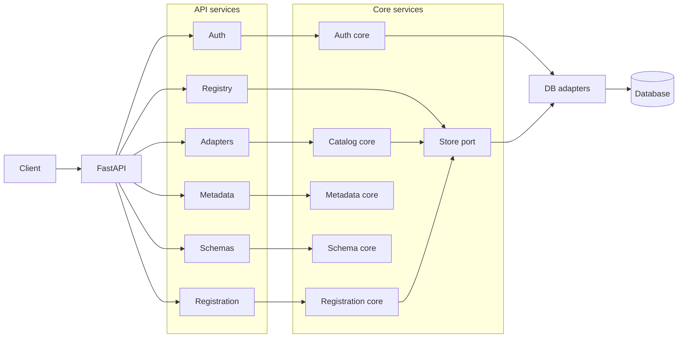

# BioCypher Components Registry

[](https://codecov.io/gh/ssciwr/biocypher-components-registry)
[](https://results.pre-commit.ci/latest/github/ssciwr/biocypher-components-registry/main)

Registry system for BioCypher adapters with metadata validation, registration workflows, persistence, and API/CLI access.

Key capabilities:

- **Automated Discovery**: Find and validate `croissant.jsonld` metadata files
- **Multi-Layer Validation**: MLCroissant + schema validation
- **Dual Database Support**: SQLite (development) and PostgreSQL (production)
- **Batch Processing**: Non-blocking registry refresh with isolated error handling
- **Multiple Interfaces**: CLI, Web UI, and REST API
- **Update History**: Recorded outcomes for published adapter updates; failed first registrations are not stored
- **Duplicate Prevention**: Enforced uniqueness by adapter id and metadata version
- **Manual Updates**: Refresh published adapters after correcting or changing repository metadata

The project contains:

- a Python backend with CLI commands and a FastAPI REST API
- SQLite support for local development and PostgreSQL support for deployment-oriented setups
- a React/Vite frontend under `frontend/` for browsing adapters and GitHub-authenticated registration
- unit and BDD tests for core, API, persistence, and CLI behavior

## Requirements

- Python 3.12+ (the Docker image uses Python 3.13)
- [uv](https://docs.astral.sh/uv/) for Python dependency management
- Node.js 24+ and pnpm for frontend development
- Docker and Docker Compose, optional for running the application; required for local PostgreSQL integration tests

## Backend Setup

The dataset generator selection and verified format capabilities are documented in
[Dataset generation backends](docs/dataset_backends.md).

Install Python dependencies:

```bash
uv sync
```

Install development dependencies, including pytest:

```bash
uv sync --group dev
```

Other optional dependency groups defined in `pyproject.toml`:

- `api-client`: installs `httpie` for ad hoc API calls (`uv sync --group api-client`)
- `performance`: installs `locust` for load testing against `locustfile.py` (`uv sync --group performance`)

Run backend tests:

```bash
uv run pytest
```

Run a specific test file:

```bash
uv run pytest tests/unit/cli/test_cli_register.py
```

Run the complete backend suite with the disposable Docker PostgreSQL database:

```bash
docker compose -f docker-compose.test.yml up -d --wait database
REGISTRY_TEST_POSTGRES_CONTAINER=biocypher-registry-test-database uv run pytest -ra
docker compose -f docker-compose.test.yml down
```

Only PostgreSQL cases skip when the variable is unset, Docker is unavailable, or
the selected container is missing or stopped. SQLite and independent tests still
run. Invalid container configuration and database/test failures remain errors.
For VS Code, set the variable in `python.envFile` (normally `.env`).

## CLI Usage

Show available commands:

```bash
uv run cli.py --help
```

Register a public HTTPS repository containing a root-level `croissant.jsonld`:

```bash
uv run cli.py register https://github.com/user/adapter-repo
```

Update an adapter registered by your GitHub account:

```bash
uv run cli.py update <adapter-id>
uv run cli.py update <adapter-id> --force-validation
```

Configure `GITHUB_OAUTH_CLIENT_ID` and `GITHUB_OAUTH_CLIENT_SECRET` in `.env` and
enable device flow for the OAuth app. Each command opens GitHub device
authentication and displays a code. The temporary user token is revoked before
processing and is never saved. The CLI calls shared services and the configured
database directly; the API and frontend do not need to be running.

Inspect registrations and events:

```bash
uv run cli.py list-registrations
uv run cli.py show-registration-events <registration-id>
uv run cli.py list-registry-entries
```

Refresh all published registrations and inspect the last batch summary:

```bash
uv run cli.py refresh-registry
uv run cli.py show-latest-refresh
```

Discover a single adapter `croissant.jsonld` from a local path or GitHub URL and validate it:

```bash
uv run cli.py discover /path/to/adapter-repo
```

Validate metadata directly:

```bash
uv run cli.py validate /path/to/croissant.jsonld
uv run cli.py validate-adapter /path/to/croissant.jsonld
uv run cli.py validate-dataset /path/to/croissant.jsonld
```

### Metadata Generation Commands

The `adapter` and `dataset` command groups generate Croissant metadata files. Each group supports `direct` (flags), `guided` (interactive prompts), and `config` (YAML file) modes:

```bash
uv run cli.py dataset guided
uv run cli.py dataset config --config dataset.yaml
uv run cli.py dataset direct --input /path/to/data --name "My Dataset" --description "..." --url "https://..." --license "CC-BY-4.0" --citation "..."

uv run cli.py adapter guided
uv run cli.py adapter config --config adapter.yaml
uv run cli.py adapter direct --name "My Adapter" --description "..." --version "1.0.0" --license "MIT" --code-repository "https://..." --keywords "graph,biology" --creator "Name, Affiliation, Identifier" --dataset-path /path/to/dataset-croissant.jsonld
```

Run `uv run cli.py adapter --help` or `uv run cli.py dataset --help` for the full flag list of each mode.

## Agentic workspace
The agentic workspace can be run through the API (see below) or directly through the command-line using
```bash
uv run python src/core/workspace/client_loop.py
```
Be aware that currently you need a Claude API key that is provided as environment variable:
```bash
export ANTHROPIC_API_KEY="<your key>"
# or
export ANTHROPIC_API_KEY_FILE="secrets/anthropic_api_key"
```
The API form serves per-session chat, directory, and file-editor routes under `/agent/api/v1` from the same FastAPI app as the routes below (BYOK: each session takes its own key via `POST /agent/api/v1/sessions/{id}/key`, no server-side `ANTHROPIC_API_KEY` needed). See [docs/API.md](docs/API.md) for the full route and SSE event contract.

For more information on the agentic workspace, consult its [dedicated documentation](docs/agentic_workspace.md).

## REST API

The REST API is a FastAPI delivery layer over the reusable core services. All
registry routes use the `/api/v1` prefix. Exact request fields, response models,
status codes, and examples are generated from the running application and should
not be duplicated manually here.

### API Documentation and Source of Truth

Start the backend with a development database:

```bash
uv run uvicorn src.api.app:app --host 0.0.0.0 --port 8000
```

| Documentation | URL | Use |
| --- | --- | --- |
| Swagger UI | http://localhost:8000/docs | Browse operations and schemas; execute local requests with **Try it out**. |
| ReDoc | http://localhost:8000/redoc | Read the generated contract in a reference-oriented layout. |
| OpenAPI JSON | http://localhost:8000/openapi.json | Automate contract checks and generate clients. |

The live OpenAPI document is authoritative. In Swagger, expand an operation to
inspect its parameters, request body, responses, errors, and component schemas.
**Try it out** calls the running service and can change its configured database.
Swagger does not bypass authentication: protected operations require the normal
GitHub browser session cookie.

Regenerate the checked-in OpenAPI document and TypeScript client after a backend
contract change:

```bash
cd frontend
pnpm run openapi-ts
```

### Service Overview

| API service | Prefix | System responsibility | Core boundary |
| --- | --- | --- | --- |
| Authentication | `/api/v1/auth` | GitHub identity and local browser sessions | `src/core/auth`, `AuthSessionStore` |
| Health | `/api/v1/health` | Process liveness | API-only |
| Adapters | `/api/v1/adapters` | Public catalog, ownership updates, endorsements, and deletion | Adapter catalog plus registration services |
| Registrations | `/api/v1/registrations` | Repository preflight, atomic registration, progress, and history | `src/core/registration` |
| Registry | `/api/v1/registry` | Published sources, canonical entries, and refresh summaries | `RegistrationStore` query boundary |
| Metadata | `/api/v1/metadata` | Validation, metadata generation, and ephemeral browser uploads | Dataset, adapter, validation, and upload services |
| Schemas | `/api/v1/schemas` | Deployed BioCypher validation schemas | `src/core/schema` |



### Authentication Service

| Method | Endpoint | Authentication | Purpose |
| --- | --- | --- | --- |
| GET | `/api/v1/auth/me` | Required | Return the signed-in GitHub identity. |
| POST | `/api/v1/auth/logout` | Session if present | Delete the local browser session and cookie. |

The browser sign-in flow also uses `GET /api/v1/auth/github/start` and
`GET /api/v1/auth/github/callback`. These redirects intentionally use
`include_in_schema=False`, so they do not appear in Swagger.

### Health Service

| Method | Endpoint | Authentication | Purpose |
| --- | --- | --- | --- |
| GET | `/api/v1/health` | Public | Confirm that the API process is alive. |

### Adapter Service

| Method | Endpoint | Authentication | Purpose |
| --- | --- | --- | --- |
| GET | `/api/v1/adapters` | Public | List public adapters from canonical registry entries. |
| GET | `/api/v1/adapters/latest` | Public | List the latest public adapter cards. |
| GET | `/api/v1/adapters/search` | Public | Search public adapter cards. |
| GET | `/api/v1/adapters/{adapter_id}` | Public | Read one adapter and its published versions. |
| GET | `/api/v1/adapters/{adapter_id}/metadata` | Public | Read the latest accepted Croissant metadata. |
| POST | `/api/v1/adapters/{adapter_id}/endorse` | Required | Endorse an adapter as the signed-in GitHub user. |
| POST | `/api/v1/adapters/{adapter_id}/update` | Owner | Fetch and process an update from the registered source. |
| DELETE | `/api/v1/adapters/{adapter_id}` | Owner | Delete an adapter and its registration data. |

### Registration Service

| Method | Endpoint | Authentication | Purpose |
| --- | --- | --- | --- |
| GET | `/api/v1/registrations/croissant-file-present-check` | Public | Check for root-level `croissant.jsonld` in a remote repository. |
| POST | `/api/v1/registrations` | Required | Fetch, validate, and atomically accept a first registration. |
| POST | `/api/v1/registrations/stream` | Required | Run the same registration with validation progress over SSE. |
| GET | `/api/v1/registrations` | Public | List accepted registration sources. |
| GET | `/api/v1/registrations/{registration_id}` | Public | Read one registration and its latest attempt. |
| GET | `/api/v1/registrations/{registration_id}/events` | Public | Read its persisted event history. |

Failed first registrations create no records and can be corrected and retried
with the same version. Published updates preserve accepted metadata on failure.
An SSE connection ending without a terminal result is unconfirmed; clients must
inspect accepted state instead of automatically repeating the POST.

### Registry Service

| Method | Endpoint | Authentication | Purpose |
| --- | --- | --- | --- |
| GET | `/api/v1/registry/registrations` | Public | List published sources with accepted and latest-attempt state. |
| GET | `/api/v1/registry/entries` | Public | List canonical valid registry entries. |
| GET | `/api/v1/registry/entries/{entry_id}` | Public | Read one canonical entry. |
| GET | `/api/v1/registry/refreshes/latest` | Public | Read the latest persisted batch-refresh summary. |

Batch refresh is a trusted CLI-only mutation (`uv run cli.py refresh-registry`);
there is no HTTP batch-trigger route or scheduler.

### Metadata Service

| Method | Endpoint | Authentication | Purpose |
| --- | --- | --- | --- |
| POST | `/api/v1/metadata/validate` | Public | Validate inline adapter or dataset metadata. |
| POST | `/api/v1/metadata/datasets/generate` | Public | Generate dataset metadata from one multipart file upload. |
| POST | `/api/v1/metadata/adapters/generate` | Public | Generate adapter metadata from existing or generated datasets. |
| POST | `/api/v1/metadata/upload-sessions` | Public | Declare a browser-prepared inventory and create an ephemeral session. |
| PUT | `/api/v1/metadata/upload-sessions/{session_id}/artifacts/{entry_id}` | Bearer session token | Stream and verify one bounded artifact. |
| POST | `/api/v1/metadata/upload-sessions/{session_id}/finalize` | Bearer session token | Queue generation, reconciliation, and validation. |
| GET | `/api/v1/metadata/upload-sessions/{session_id}` | Bearer session token | Poll state and retrieve the terminal result. |
| DELETE | `/api/v1/metadata/upload-sessions/{session_id}` | Bearer session token | Cancel or release the ephemeral session. |

The browser workflow accepts UTF-8 CSV/TSV data, including `.csv.gz` and
`.tsv.gz`, with at most 1,000 files, 1 MiB per prepared artifact, and 50 MiB per
session. Dataset bytes are kept out of the registry database and persistent
volumes. See [Dataset generation backends](docs/dataset_backends.md) for the
selection, sampling, reconciliation, and resource contracts.

### Schema Service

| Method | Endpoint | Authentication | Purpose |
| --- | --- | --- | --- |
| GET | `/api/v1/schemas/{version}` | Public | Return a deployed BioCypher adapter JSON Schema, such as `v1`. |

### Shared API Behavior

- FastAPI validation failures use `422`; operation-specific errors use the
  documented status and response shown in Swagger.
- Registration progress uses Server-Sent Events. Upload artifacts use raw
  request bodies; other control-plane operations use JSON.
- List endpoints omit full Croissant documents. Use adapter metadata or detail
  endpoints for full accepted metadata.
- Backward-compatible changes remain under `/api/v1`; incompatible contracts
  require a future major path.
- API routes translate HTTP concerns and delegate business rules to core
  services; they do not access SQLAlchemy tables directly.

### Hidden and Optional APIs

- OAuth start/callback redirects are implemented but hidden from OpenAPI with
  `include_in_schema=False`.
- Agentic-workspace routes use `/agent/api/v1` and are absent from Swagger when
  `agentic_api_active` is disabled. Their separate authentication, SSE, and
  file contracts are documented in [Agentic Workspace API](docs/API.md).
- Batch refresh is available through the CLI, not an HTTP mutation endpoint.

### Complete Endpoint Index

The service tables above list every operation in the active `/api/v1` Swagger
contract, grouped by responsibility. Use http://localhost:8000/docs for exact
models and interactive requests, or http://localhost:8000/openapi.json for a
machine-readable flat index. When these tables and the live contract disagree,
the live OpenAPI document is authoritative and this chapter must be updated.

## Frontend Setup

The React/Vite frontend lives in `frontend/`.

Install dependencies:

```bash
cd frontend
pnpm install
```

Run the development server:

```bash
pnpm run dev
```

Run frontend checks:

```bash
pnpm run lint
pnpm run build
pnpm run ui-tests
```

The frontend consumes `/api/v1` through the browser-reachable API origin set by
`VITE_API_BASE_URL`. During local development this is normally
`http://localhost:8000`. In production, the frontend and API paths normally
share one HTTPS Nginx origin; Nginx forwards those paths to the private FastAPI
service using `BACKEND_INTERNAL_URL`. FastAPI itself is not directly exposed.

## Database Configuration

For CLI commands, choose one configuration below in your root `.env` file.
The CLI reads it automatically. Keep your authentication and other settings.

### SQLite

Select SQLite and set its host-local path:

```dotenv
DATABASE_BACKEND=sqlite
SQLITE_DATABASE_PATH=registry.sqlite3
```

`SQLITE_DATABASE_PATH` is the **SQLite file path**. Here, the file is
`registry.sqlite3` in the directory where you run the command. You can use an
absolute path such as `/home/you/registry.sqlite3` instead. The file is created
if missing; no database server or Docker container is needed.

```bash
uv run cli.py list-registrations
```

### PostgreSQL

Set a host and the PostgreSQL credentials:

```dotenv
DATABASE_BACKEND=postgresql
POSTGRES_HOST=127.0.0.1
POSTGRES_PORT=5432
POSTGRES_USER=biocypher
POSTGRES_DB=biocypher_registry
POSTGRES_PASSWORD=your-database-password
```

Use your existing database credentials, or choose them when creating a fresh
database. SQLite settings are ignored when PostgreSQL is selected.

Start the local PostgreSQL container, then run the same CLI command:

```bash
docker compose -f docker-compose-postgresql.yml up -d --wait database
uv run cli.py list-registrations
```

For an existing PostgreSQL server, use its host/port and skip the Docker command.
The API and frontend do not need to be running.

For a containerized backend, choose the SQLite or PostgreSQL Compose file below;
Compose sets the container's database connection automatically.

Switching databases does not copy existing records.

## Docker Compose

Docker files are available for local backend/database experiments:

```bash
docker compose -f docker-compose-sqlite.yml up
docker compose -f docker-compose-postgresql.yml up
```

The compose files expose the backend API on http://localhost:8000. The backend runs as the unprivileged `apiuser`; fresh named volumes inherit the writable `/app/data` directories from the image. The PostgreSQL compose file also exposes the database on port 5432 and requires `POSTGRES_PASSWORD` to be set (via a `.env` file with `KEY=VALUE` lines or exported shell variables); it fails fast if that variable is missing. `POSTGRES_DB` and `POSTGRES_USER` are optional and default to `biocypher_registry` and `biocypher`. The frontend service in both compose files points at a `./frontend-placeholder` directory and only serves a static Nginx placeholder; it is not wired to the real `frontend/` app. For frontend development, use the Vite workflow in `frontend/` instead.

If an existing sqlite database has issues for local development, I recommend to wipe it and remount hte volume/restart the docker container completely.

## Project Structure

```text
biocypher-components-registry/
├── cli.py                         # CLI entry point (registration, validation, metadata generation)
├── locustfile.py                  # Optional Locust load-testing scenario
├── frontend/                      # React/Vite frontend
├── src/
│   ├── api/                       # FastAPI REST API layer
│   │   ├── app.py                 # Application factory
│   │   ├── routers/                # health, adapters, registrations, registry, metadata
│   │   └── schemas/                 # Request/response models
│   ├── core/                      # Business logic: adapter, dataset, registration, schema, validation
│   └── persistence/               # SQLite/PostgreSQL adapters and SQLAlchemy tables
├── data/in/                       # Sample Croissant metadata and datasets used by tests/CI
├── tests/                         # Python unit and BDD tests
├── sdlc_docs/                     # Requirements, design docs, ADRs, verification notes
├── docker-compose-sqlite.yml
├── docker-compose-postgresql.yml
├── pyproject.toml
└── uv.lock
```

## CI

GitHub Actions workflows are stored in `.github/workflows/`.

- `backend.yml`: starts a PostgreSQL 16 Docker container on the GitHub runner, supplies its ID through `REGISTRY_TEST_POSTGRES_CONTAINER`, and runs pytest with coverage uploaded to Codecov. The test container and database are removed after the job. Triggered by backend/test/dependency/Compose/workflow pull-request changes.
- `frontend.yml`: installs frontend dependencies with pnpm, then runs lint, build, and Cypress UI tests. Triggered on pull requests touching `frontend/`.
- `validate_schema.yml`: validates the sample `data/in/adapter_collectri/collectri.json` Croissant file against the schema using the `ssciwr/validate-croissant-schema` action.

Run Cypress locally from `frontend/` after installing the project-specific Cypress binary:

```bash
pnpm cypress install
pnpm run ui-tests
```

## Documentation

- `sdlc_docs/b_design/architecture.md`: overall architecture
- `sdlc_docs/b_design/backend/`: backend and persistence design
- `sdlc_docs/b_design/frontend/`: frontend architecture and API contract
- `sdlc_docs/c_verification/`: manual verification notes and compatibility checks

## Environment Variables

| Variable | Description | Default |
| --- | --- | --- |
| `DATABASE_BACKEND` | Explicit database backend: `sqlite` or `postgresql` | `sqlite` in `.env.example` |
| `SQLITE_DATABASE_PATH` | SQLite file path used when SQLite is selected | `registry.sqlite3` |
| `POSTGRES_HOST` | PostgreSQL hostname used when PostgreSQL is selected | `127.0.0.1` in `.env.example` |
| `POSTGRES_PORT` | PostgreSQL port | `5432` |
| `POSTGRES_DB` | PostgreSQL database name | `biocypher_registry` |
| `POSTGRES_USER` | PostgreSQL user | `biocypher` |
| `POSTGRES_PASSWORD` | PostgreSQL password | required when using PostgreSQL components or Compose |
| `GITHUB_OAUTH_CLIENT_ID` | GitHub OAuth app Client ID for browser and CLI authentication | required for sign-in; no default |
| `GITHUB_OAUTH_CLIENT_SECRET` | OAuth app secret used by the API and CLI; never expose to the frontend | required for sign-in; no default |
| `AUTH_SESSION_SECRET` | Separate secret used to sign and verify OAuth state; backend only | required for sign-in; no default |
| `FRONTEND_BASE_URL` | Frontend URL used for sign-in redirects and allowed origins | `http://localhost:5173` |
| `VITE_API_BASE_URL` | Browser-reachable API origin used by React and to construct OAuth callbacks; omit `/api/v1`. It normally equals the Nginx site origin in production. | `http://localhost:8000` in local development |
| `BACKEND_INTERNAL_URL` | Private Nginx-to-FastAPI address on the container network; never browser-visible | `http://backend:8000` |
| `REGISTRY_ALLOWED_REPOSITORY_HOSTS` | Allowed repository hosts; explicitly approve self-hosted authorities | `github.com,gitlab.com` |
| `REGISTRY_TEST_POSTGRES_CONTAINER` | Labeled Docker PostgreSQL test container name or ID | unset; PostgreSQL cases skip |

## Troubleshooting

If a CLI command is not found, use `uv run` from the repository root:

```bash
uv run cli.py --help
```

If the API port is already in use, choose another port:

```bash
uv run uvicorn src.api.app:app --host 0.0.0.0 --port 8080
```

If `docker compose -f docker-compose-postgresql.yml up` exits immediately with a `POSTGRES_PASSWORD is required` error, set `POSTGRES_PASSWORD` (and optionally `POSTGRES_DB`/`POSTGRES_USER`) as shell environment variables or in a `.env` file using `KEY=VALUE` syntax (not `KEY:VALUE`) before starting the stack.

If dependency installation fails, confirm that network access is available for Python packages, Git dependencies, and npm packages used by the frontend.

## Contributing

See `CONTRIBUTING.md` for contribution guidelines.

## License

See `LICENSE` for details.
