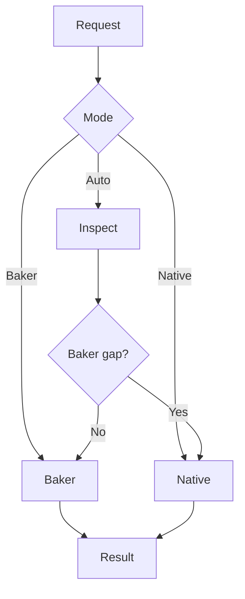
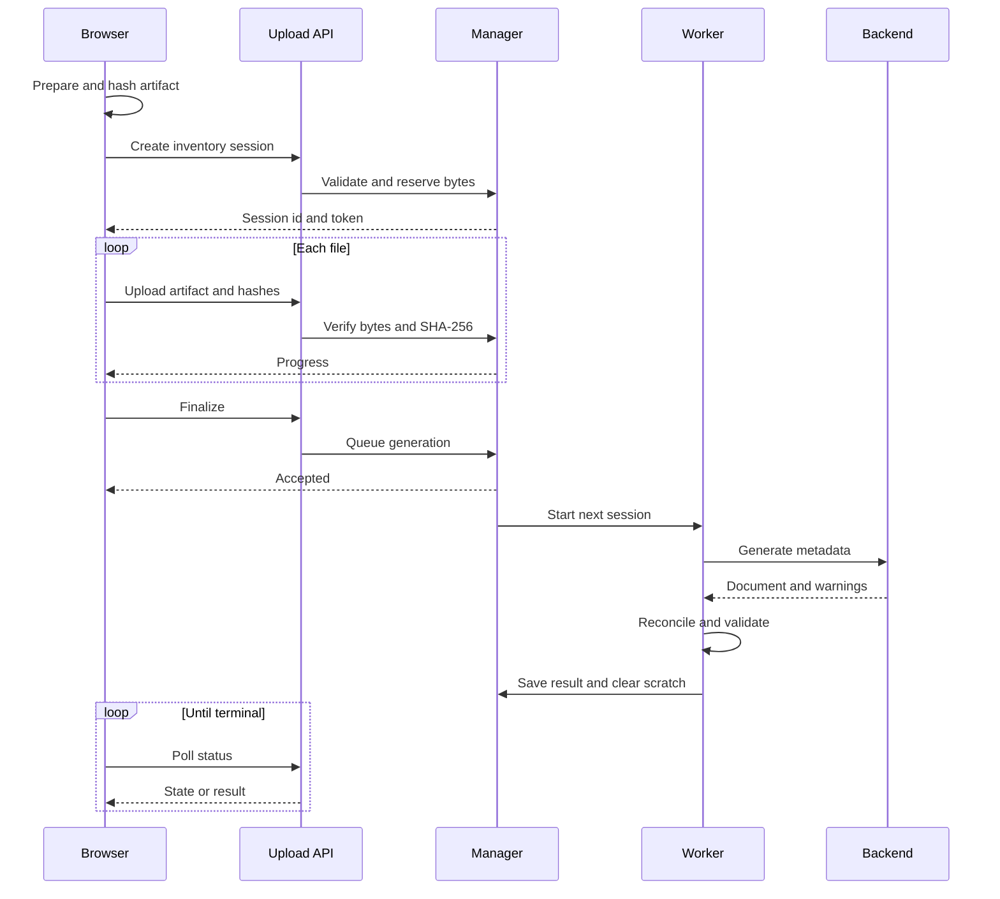
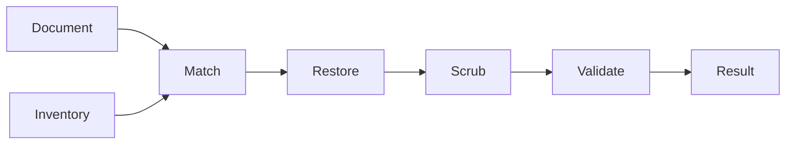
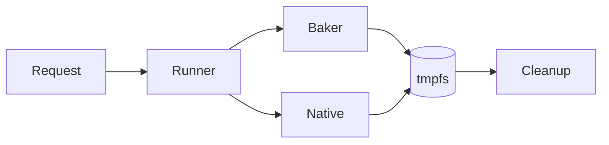

# Dataset Generation Backends

The registry generates Croissant dataset metadata with two independent backends:

- **Croissant Baker** — preferred, with broad format coverage.
- **Native** — the registry's tabular-data implementation.

Both use the same service interface and bounded subprocess boundary. This guide
separates backend selection, direct generation, and the narrower browser-upload
contract. For system context, see [architecture.md](../sdlc_docs/b_design/architecture.md).
Exact HTTP schemas remain authoritative in runtime Swagger at `/docs`.

## Backend Selection

| Selection | Behavior |
| --- | --- |
| `auto` | Prefer Baker. Select Native only if Native supports every file and Baker is marked unsupported for at least one. |
| `croissant-baker` | Run Baker directly. |
| `native` | Run Native directly; fail if any file lacks a Native handler. |

Selection happens before execution. `auto` never falls back to Native after a
Baker launch, timeout, resource, or generation failure. All current Native
handlers are also Baker-supported, so `auto` currently selects Baker for known
inputs.

## Backend Comparison

| Concern | Baker | Native |
| --- | --- | --- |
| Role | Default, broad coverage | Registry-owned tabular generator |
| Implementation | External `croissant-baker` CLI | Private builder in a child process |
| Input | Baker-supported formats | CSV, TSV, CSV.GZ, TSV.GZ, Parquet |
| Unsupported folder files | May produce partial scan warnings | Fails the request |
| Inspection | Baker handlers | Up to 500 delimited rows; Parquet metadata |
| Validation | Baker validation when requested | Shared dataset validation when requested |

Native Parquet inspection reads Arrow schema and row-count metadata without
loading the table. Delimited inspection infers simple Croissant text, integer,
float, and boolean types.

## Format Coverage

Direct API and CLI generation can use the selected backend's full capability.
Browser uploads deliberately support less.

| Format group | Baker 0.8.0 | Native | Browser upload |
| --- | --- | --- | --- |
| CSV, TSV | Yes | Yes | Yes |
| CSV.GZ, TSV.GZ | Yes | Yes | Yes |
| Parquet | Yes | Yes | No |
| Bzip2, XZ | Yes | No | No |
| JSON, JSONL, FHIR, spreadsheets | Yes | No | No |
| Genomics and medical formats | Yes | No | No |
| HDF5, GEO SOFT, WFDB | Yes | No | No |
| ZIP, TAR, multi-member archives | Reported, not opened | No | No |

The Baker column reflects `uv.lock`. A Baker upgrade requires rechecking this
table and Native handlers' `croissant_baker_supported` declarations. Browser
support expands only with matching preparation, validation, reconciliation, and
tests.

## Browser Upload Flow

The browser hashes original bytes and prepares complete small files or bounded,
complete-row samples before creating a backend session.

Protocol:

1. `POST /api/v1/metadata/upload-sessions` declares the inventory and returns a
   session id plus bearer token.
2. `PUT /api/v1/metadata/upload-sessions/{session_id}/artifacts/{entry_id}`
   streams one artifact with `X-Artifact-SHA256` and `X-Original-SHA256`.
3. `POST /api/v1/metadata/upload-sessions/{session_id}/finalize` queues work and
   returns `202`.
4. `GET /api/v1/metadata/upload-sessions/{session_id}` returns state or result.
5. `DELETE /api/v1/metadata/upload-sessions/{session_id}` cancels before
   finalization or releases a consumed session.

The token uses `Authorization: Bearer <token>`. Polling does not extend session
deadlines.

## Limits and Sampling

| Limit | Value |
| --- | ---: |
| Files per source | 1,000 |
| Artifact | 1 MiB |
| Artifacts per session | 50 MiB |
| Active sessions | 100 |
| Reserved scratch | 110 MiB |
| Concurrent generation | 1 |
| Start upload | 60 seconds |
| Idle session / terminal result | 10 minutes |
| Generator timeout | 120 seconds |
| Generated JSON | 10 MiB |
| Captured stdout or stderr | 16 KiB each |

| Source | Preparation strategy |
| --- | --- |
| Plain file up to 1 MiB | `complete-file-v1` |
| Larger CSV / TSV | `csv-complete-rows-v1` / `tsv-complete-rows-v1` |
| CSV.GZ / TSV.GZ | `csv-gzip-complete-rows-v1` / `tsv-gzip-complete-rows-v1` |

Admission failure returns `429` with `Retry-After`. The browser can retry while
prepared artifacts remain in memory.

## Reconciliation

Samples represent original files, so browser generation adds a strict
reconciliation step:

Each declared source must match exactly one generated `FileObject`. The
reconciler restores original name, relative `contentUrl`, byte size, SHA-256,
encoding, and Croissant 1.0 profile. It removes scratch paths, `file:` and
`data:` values, transient hashes, upload fields, inline samples, and sampled row
counts. Missing, extra, or ambiguous matches fail.

User-provided `contentUrl` is metadata only: the registry preserves but does not
download or compare it with the selected source.

## Success, Warnings, and Privacy

Baker succeeds on exit code zero. Its scan report adds bounded warnings:
`described`, `linked`, and `referenced` are accepted outcomes; omitted files and
diagnostics become warnings. The browser contract is stricter: every declared
file must appear exactly once. Native also fails if any file cannot be inspected.

Both backends use a secret-free environment; wall-clock, CPU, memory, file, and
descriptor limits; bounded diagnostics; and restricted scratch. Browser data is
never stored in the registry database or a persistent volume. Cleanup runs on
success, failure, expiry, cancellation, deletion, and shutdown. See
[deployment.md](deployment.md) for the deployment contract.

## Developer Guide

| Concern | Location |
| --- | --- |
| Backends and auto-selection | `src/core/dataset/backends` |
| Native format handlers | `src/core/dataset/formats` |
| Bounded execution | `src/core/dataset/process.py` |
| Upload sessions and limits | `src/core/dataset/upload` |
| Upload routes | `src/api/routers/dataset_uploads.py` |
| Browser preparation | `frontend/src/pages/createMetadata` |

To add a format:

1. Implement or update backend support.
2. For Native, add a `FormatHandler` and declare Baker support.
3. Update auto-selection tests.
4. For browser support, add a versioned strategy, capability validation,
   reconciliation, and frontend/API tests.
5. Update this guide after verifying the implementation.
