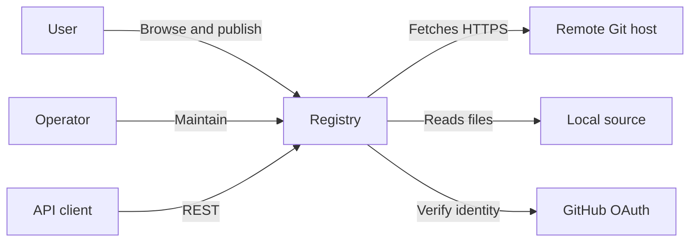
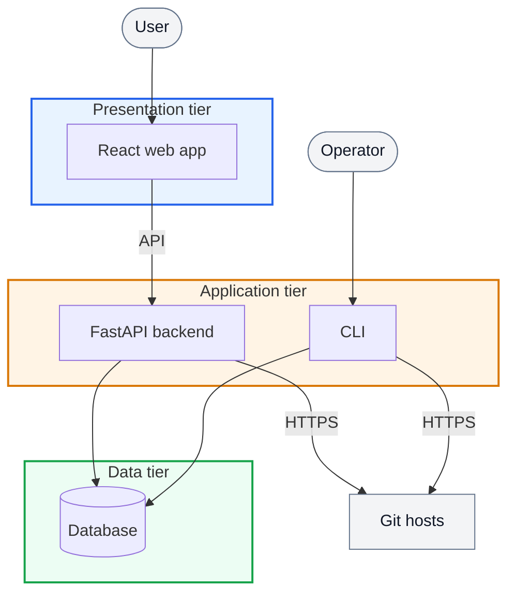
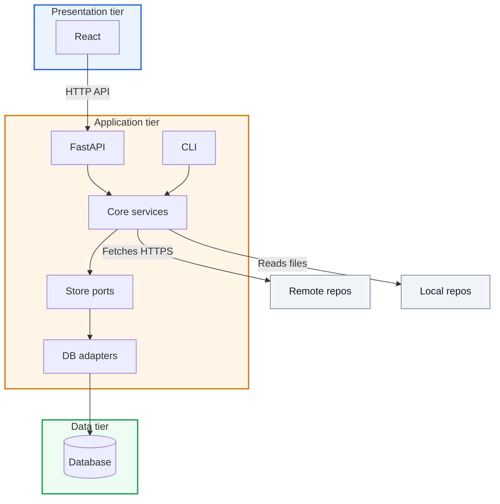
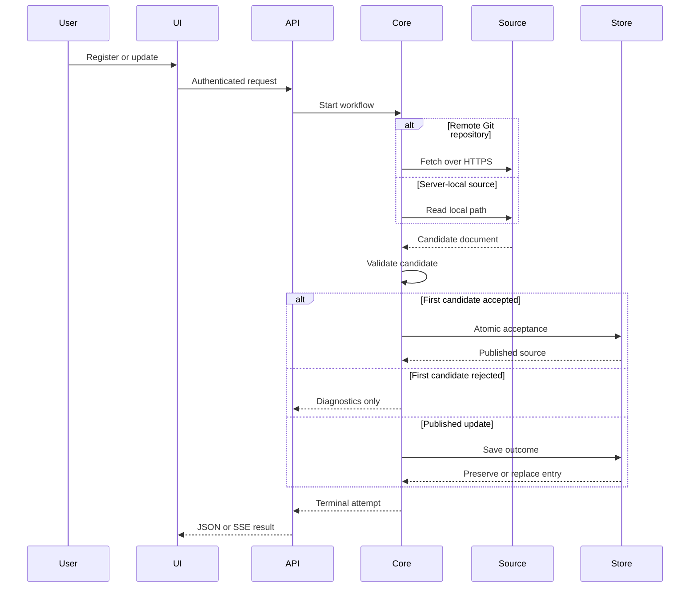
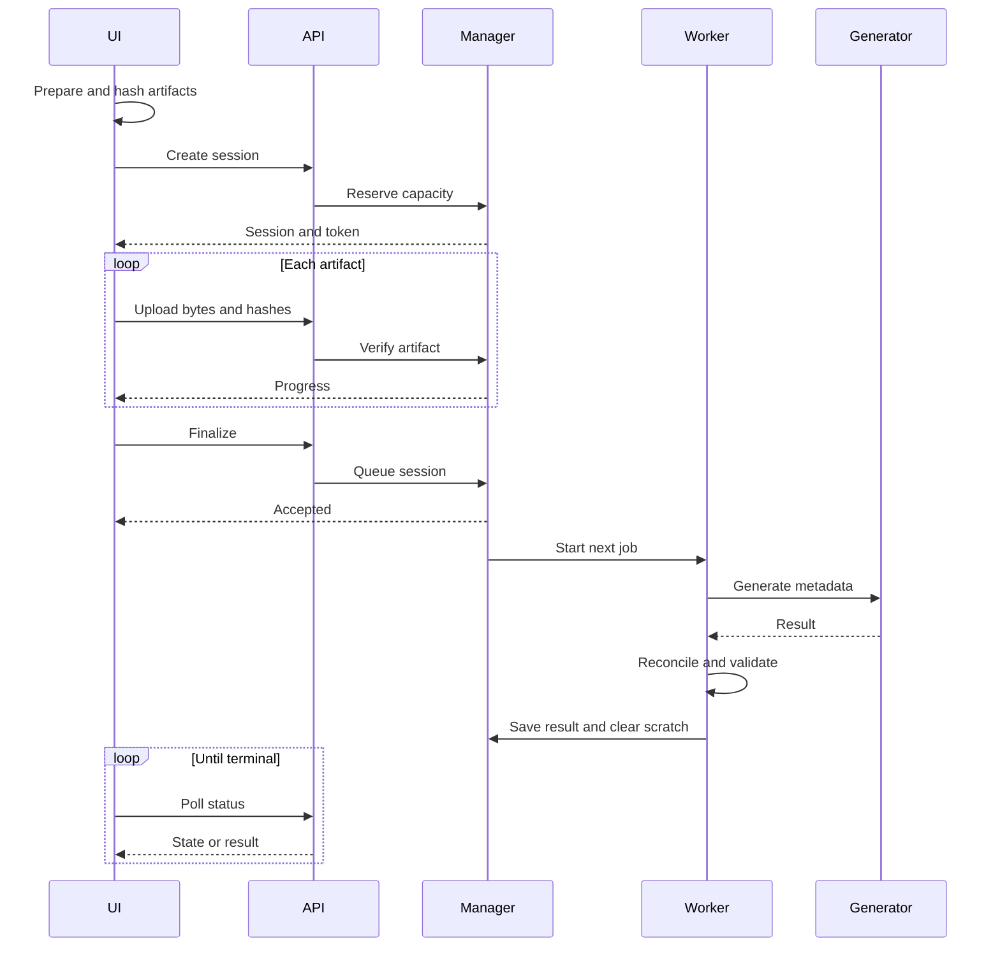
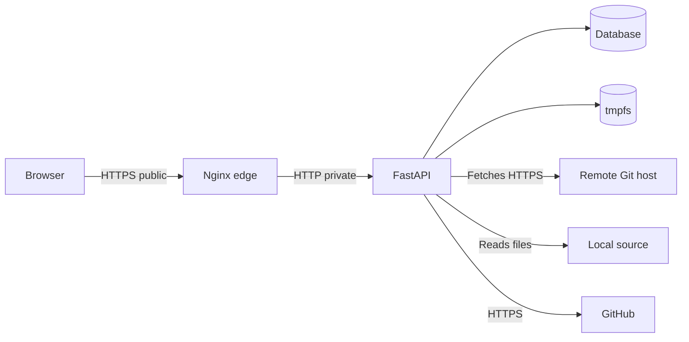

# BioCypher Components Registry Architecture

## 1. Introduction and Goals

### 1.1 Purpose

The BioCypher Components Registry lets users publish, validate, discover, and
maintain metadata for BioCypher adapters. It exposes the same core behavior
through a React application, a FastAPI REST API, and a command-line interface.

This document is the main architectural entry point. It describes the current
system from context to implementation boundaries using:

- the **arc42** structure for architectural concerns; and
- the **C4 model** for progressively detailed system views.

Exact HTTP request and response contracts are generated by FastAPI and belong
in runtime Swagger/OpenAPI. Focused documents linked from this guide own detailed
API, frontend, persistence, database, and deployment design.

### 1.2 Stakeholders

| Stakeholder | Architectural need |
| --- | --- |
| Registry users | Discover accepted adapters and inspect their metadata. |
| Adapter maintainers | Register repositories and safely update owned adapters. |
| Registry operators | Run and inspect maintenance workflows. |
| Frontend contributors | Use a stable HTTP contract without depending on Python internals. |
| Backend contributors | Reuse business behavior across API and CLI delivery layers. |
| Deployers | Choose SQLite or PostgreSQL and protect transient dataset data. |

### 1.3 Architectural Goals

The architecture prioritizes:

1. **Correct publication:** only accepted metadata becomes canonical.
2. **Actionable validation:** callers receive structured checks and diagnostics.
3. **Reusable business behavior:** API and CLI call the same core services.
4. **Explicit persistence boundaries:** SQLite and PostgreSQL implement one port.
5. **Transient dataset handling:** browser uploads never enter durable storage.
6. **Low operating cost:** the MVP uses one backend process and manual registry
   maintenance rather than distributed coordination and scheduling.
7. **Low maintenance cost:** generated contracts and focused documents prevent
   duplicated sources of truth.

### 1.4 Current Scope

Implemented capabilities include:

- GitHub-authenticated first registration and owner-authorized updates;
- remote Git repository or server-local source retrieval, validation, duplicate
  prevention, and atomic acceptance;
- canonical registry entries and update-attempt history;
- public adapter discovery and metadata reads;
- adapter and dataset metadata generation;
- browser file/folder preparation with ephemeral upload sessions;
- SQLite and PostgreSQL persistence;
- manual CLI batch refresh with persisted summaries; and
- an optional agentic-workspace API with its own contract and deployment concerns.

### 1.5 Non-Goals

The current product does not provide:

- scheduled registry refresh;
- automatic retry or notification delivery;
- horizontally coordinated upload sessions;
- an MCP delivery adapter for registry retrieval; or
- automatic migration of historical database schemas.

These are future options, not missing prerequisites for the MVP.

## 2. Constraints

### 2.1 Product and Organizational Constraints

| Constraint | Consequence |
| --- | --- |
| Deliver useful registry workflows quickly | Prefer maintained frameworks and a small number of runtime services. |
| Frontend may move to another repository | React communicates only through HTTP contracts. |
| API and CLI must behave consistently | Business rules remain in reusable core services. |
| Small-team maintenance cost matters | Avoid parallel implementations, copied schemas, and unnecessary infrastructure. |

### 2.2 Technical Constraints

| Constraint | Consequence |
| --- | --- |
| REST API uses FastAPI under `/api/v1` | Swagger/OpenAPI is the authoritative HTTP contract. |
| Persistence supports SQLite and PostgreSQL | Both adapters implement `RegistrationStore`. |
| Browser upload sessions are process-local | Run one backend replica and one Uvicorn worker. |
| Upload scratch must be ephemeral | Use restricted `tmpfs`; never use the registry database or persistent volumes. |
| Publication ownership uses GitHub identity | Registration and updates require verified authentication. |
| Batch refresh is trusted maintenance | Mutation is CLI-only; the API exposes the latest summary as a read. |

### 2.3 Security Constraints

- GitHub-protected routes require the normal authenticated browser session.
- Remote repository access uses an explicit authority policy. Server-local
  sources bypass the network policy and are intended for development and
  integration use.
- Dataset artifacts are bounded, hash-verified, stored transiently, and removed
  after processing or session cleanup.
- Generator subprocesses use a sanitized environment and resource limits.
- Agentic-workspace security is documented separately because it executes
  model-selected commands and has a different threat model.

## 3. System Scope and Context

### 3.1 C4 Level 1 — System Context



### 3.2 Context Responsibilities

| Element | Responsibility |
| --- | --- |
| User | Browses adapters, generates metadata, registers repositories, and updates owned adapters. |
| Operator | Configures deployment and runs trusted batch maintenance. |
| API client | Reads registry data or invokes supported workflows through `/api/v1`. |
| Registry | Validates, publishes, queries, and maintains adapter metadata. |
| Remote Git host | External GitHub, GitLab, or explicitly allowed host containing root-level metadata on the default branch. |
| Local source | Server-local repository directory accepted for development and integration workflows. |
| GitHub OAuth | Verifies the stable account identity used for ownership. |

Normal browser and CLI publication use public HTTPS repositories. The shared
service also accepts server-local paths for development and integration tests;
those paths are resolved by the backend process and are not browser-local paths.

The optional agentic workspace helps create adapter code but is not part of the
registry publication boundary shown above. It uses a separate `/agent/api/v1`
contract and is disabled unless explicitly enabled.

## 4. Solution Strategy

The system is organized in three runtime tiers:

1. **Presentation tier:** the React web application.
2. **Application tier:** FastAPI and the CLI, both using shared core services.
3. **Data tier:** the configured SQLite or PostgreSQL database runtime.

Inside the application tier, the backend code uses layered dependencies:

1. **Delivery components** translate HTTP or CLI input and output.
2. **Core services** own registration, validation, generation, and workflow rules.
3. **Registration store ports** define required persistence behavior.
4. **Persistence adapters** implement those ports for SQLite and PostgreSQL.

The three-tier structure, internal layers, and persistence ports are complementary
views rather than competing architecture labels. The ports-and-adapters claim is
intentionally narrow. Repository access through Git and GitHub identity checks
through HTTPS are concrete infrastructure used by core services in the current
MVP; they are not abstracted behind application ports.

Important strategic decisions are:

- validate a first candidate before creating any registration records;
- preserve the last accepted entry when a later update fails;
- separate accepted publication state from the latest processing attempt;
- use checksums for unchanged detection and identity/version keys for duplicates;
- generate OpenAPI from FastAPI rather than maintaining a second schema;
- keep browser dataset bytes ephemeral and outside persistent storage; and
- defer scheduling and distributed session coordination until demand justifies
  their operational cost.

In logical architecture views, **HTTP API** describes the application contract,
not a concrete network scheme. Deployment views distinguish local HTTP, public
HTTPS, and private container-network HTTP. The detailed convention is defined
in [Deployment Design](deployment.md#transport-conventions).

## 5. Building Block View

### 5.1 C4 Level 2 — Runtime Containers



This view shows runtime units, not Python packages. The web app communicates
with the backend only through its HTTP API. The CLI is a separate process that
imports the shared core packages and constructs its own configured store; it
does not call FastAPI. Server-local sources are an alternative backend/CLI
input and are omitted here to keep the primary runtime relationships clear.

Blue, orange, and green groups represent the presentation, application, and
data tiers. Gray nodes are people or external systems. Rectangles are runtime
applications; the cylinder is durable storage.

### 5.2 Container Responsibilities

| Runtime container | Technology | Responsibility |
| --- | --- | --- |
| Web application | TypeScript, React | Browser interaction, presentation, dataset preparation, and API consumption. |
| Backend service | Python, FastAPI | HTTP/SSE delivery and execution of shared application workflows. |
| CLI process | Python, Typer | Direct execution of shared workflows and trusted maintenance commands. |
| Database runtime | SQLite or PostgreSQL | Durable registrations, entries, events, summaries, sessions, and endorsements. |

Nginx is an edge/deployment concern rather than a business-application
container in this logical view. Core services, ports, and persistence adapters
are components inside the backend or CLI process and appear at Level 3.

### 5.3 C4 Level 3 — Components Within the Tiers

This view combines the runtime tiers with the main application-tier components.
React reaches application behavior only through FastAPI. The CLI bypasses HTTP
but calls the same core services. Store ports and database adapters are code
inside the application tier; only the database runtime belongs to the data tier.



Core services include authentication, catalog, registration, metadata,
validation, and upload workflows. The component-to-package map below provides
the implementation detail without duplicating every dependency in the diagram.

### 5.4 Component-to-Package Map

| Component | Package | Owns |
| --- | --- | --- |
| API routes | `src/api/routers` | HTTP routes grouped by workflow/resource. |
| API schemas | `src/api/schemas` | Pydantic request and response contracts. |
| API composition | `src/api/app.py`, `dependencies.py` | Application lifecycle and dependency wiring. |
| Auth core | `src/core/auth` | GitHub identity, browser authentication, and CLI device flow. |
| Adapter core | `src/core/adapter` | Catalog helpers, discovery, and adapter generation. |
| Dataset core | `src/core/dataset` | Dataset generation, formats, backends, processes, and uploads. |
| Registration core | `src/core/registration` | Registration/update use cases, models, errors, and store port. |
| Validation core | `src/core/validation` | Compliance, schema, semantic, dataset, and progress diagnostics. |
| Shared core | `src/core/shared` | Repository policy, JSON sources, files, IDs, constants, creators, and licenses. |
| Schema profiles | `src/core/schema` | Bundled schema and profile loading. |
| Persistence | `src/persistence` | SQLite/PostgreSQL stores, tables, initialization, and factory. |
| Frontend | `frontend/src` | Pages, components, workflow modules, and generated API client. |

### 5.5 Dependency Rules

Allowed dependencies:

```text
frontend -> API through HTTP only
API -> core services
API -> persistence factory for composition only
CLI -> core services and persistence factory
registration core -> registration store ports
repository and authentication core -> concrete Git and HTTPS infrastructure
persistence -> registration store ports/models and database libraries
```

Disallowed dependencies:

```text
frontend -> Python internals or database
core business rules -> FastAPI, React, SQLAlchemy tables, or concrete stores
persistence -> API or frontend
API routes -> SQLAlchemy tables directly
```

## 6. Runtime View

### 6.1 First Registration and Update



Key rules:

- A rejected first candidate creates no source, entry, or event.
- First acceptance commits its source, canonical entry, pointer, and success
  event atomically.
- A failed update retains the accepted entry and appends terminal history.
- Changed metadata must preserve identity and use a different unused version
  label; semantic version ordering is not enforced.
- An SSE check is progress, not publication confirmation. Only the terminal
  result follows persistence.

### 6.2 Browser Dataset Upload and Generation



The browser prepares complete small files or bounded complete-row samples. The
server verifies the transient artifact hashes, serializes generation through one
worker, reconciles output with the declared inventory, validates the result, and
deletes scratch data. Only a bounded result remains briefly for polling.

Detailed capability and limit contracts are maintained in
[Dataset generation backends](../../docs/dataset_backends.md) and
[Deployment and security architecture](../../docs/deployment.md).

### 6.3 Manual Batch Refresh

The trusted CLI reads active registration identifiers, processes each source
independently through the shared update workflow, and persists one aggregate
summary. A failure for one source does not stop the batch. The read-only API
exposes the latest completed summary.

Automatic schedules, retry backoff, notifications, and a browser batch trigger
are intentionally outside the current MVP.

## 7. Deployment View

### 7.1 C4 Deployment View



### 7.2 Development Deployment

- Vite serves the React application.
- Uvicorn serves FastAPI.
- Browser traffic to Vite and Uvicorn uses HTTP on localhost.
- SQLite stores durable registry data in one file.
- The developer may run the CLI against the same configured database.
- Docker Compose is optional except for local PostgreSQL integration tests.

### 7.3 Production-Oriented Deployment

- A web server serves the built frontend and proxies API traffic.
- Browser traffic reaches Nginx over public HTTPS; Nginx reaches FastAPI over
  HTTP on the private container network.
- One backend container runs one Uvicorn worker while upload sessions remain
  process-local.
- PostgreSQL runs as the durable database tier.
- `/run/biocypher-upload-scratch` is a restricted shared `tmpfs` inside the
  backend container, not a named or persistent volume.
- Nginx disables buffering and caching for upload-session traffic.

Horizontal backend scaling requires a separately designed shared session
coordinator or request affinity plus shared state. Adding replicas before that
redesign would route session requests to processes that do not own the session.

## 8. Cross-Cutting Concepts

### 8.1 Authentication and Ownership

Browser publication uses a GitHub-backed cookie session. CLI publication uses
GitHub device authorization, verifies the stable account identifier, and revokes
the temporary user token before processing. The verified account owns accepted
sources. Updates and deletion require ownership of all sources for the adapter
identity.

### 8.2 Validation and Diagnostics

Registration validation covers:

- remote Git retrieval or server-local file loading and JSON parsing;
- Croissant compliance;
- the BioCypher adapter schema/profile;
- semantic adapter checks; and
- every embedded dataset fragment.

Validation checks include status, provenance, errors, and available JSON/file
positions. API, CLI, registration, and metadata utilities reuse the same
validation modules.

### 8.3 Canonical Identity and Duplicates

The canonical uniqueness key combines adapter identity and metadata version.
Remote URLs and local paths are normalized according to their source kind before
duplicate checks. Missing metadata
`@id` uses the same name-based fallback across registration, reads, and updates.
Ownership and uniqueness are checked inside the acceptance transaction to
protect against concurrent submissions.

### 8.4 Publication and Attempt State

Accepted publication state is independent of the latest processing attempt:

```text
published_version    last accepted metadata version
attempt_status       SUCCEEDED or FAILED for one completed operation
update_applied       whether that operation changed the accepted entry
latest_event_type    most recent persisted event for a published source
```

There is no public registration lifecycle `status` field.

### 8.5 Persistence and Transactions

`RegistrationStore` is the application-facing persistence boundary. SQLite and
PostgreSQL share the same SQLAlchemy table model and core semantics. First
acceptance is atomic. Update failures append history without replacing accepted
metadata. Fresh-schema initialization is supported; historical upgrades require
an explicit migration plan.

### 8.6 Ephemeral Uploads

Upload session state, bearer capabilities, reservations, terminal results, and
scratch paths are local to one backend process. Artifacts are size-bounded,
SHA-256 verified, and stored only under restricted `tmpfs`. Success, failure,
expiry, cancellation, deletion, and shutdown release scratch and reservations.

### 8.7 Configuration

Database selection is explicit:

```text
DATABASE_BACKEND=sqlite | postgresql
SQLITE_DATABASE_PATH
POSTGRES_HOST / POSTGRES_PORT / POSTGRES_USER / POSTGRES_PASSWORD / POSTGRES_DB
```

API authentication, frontend origin, repository authorities, and optional
workspace settings are configured separately. Upload protocol limits are code
constants, not deployment-tunable environment variables.

### 8.8 API Contract

FastAPI-generated OpenAPI is authoritative for exact endpoints and schemas:

```text
Swagger UI:   http://localhost:8000/docs
ReDoc:        http://localhost:8000/redoc
OpenAPI JSON: http://localhost:8000/openapi.json
```

The REST API organization and service endpoint inventory are documented in the
repository [README](../../README.md#rest-api). OAuth redirects hidden with
`include_in_schema=False` and disabled optional routers do not appear in runtime
Swagger.

### 8.9 Testing

- Core tests cover business behavior independently of HTTP.
- API tests cover contracts, authentication, mapping, and upload sessions.
- Persistence tests run against SQLite and an optional disposable PostgreSQL
  container.
- Frontend unit tests cover workflow modules and components.
- Cypress covers important browser flows.
- BDD scenarios map registration behavior to user stories.

## 9. Architectural Decisions

| ADR | Decision | Consequence |
| --- | --- | --- |
| [ADR-0001](adr/ADR-0001-repository-layout.md) | Keep React at top level and Python under `src`. | Frontend can be separated later without moving backend packages. |
| [ADR-0002](adr/ADR-0002-api-style-fastapi-rest-openapi.md) | Use FastAPI, REST, and OpenAPI. | Runtime OpenAPI is the HTTP contract source of truth. |
| [ADR-0003](adr/ADR-0003-frontend-split-strategy.md) | Delay the frontend repository split. | Split only after contract and workflow stability justify it. |
| [ADR-0004](adr/ADR-0004-deferred-decisions.md) | Defer selected operational features. | Scheduling, notifications, and operator APIs remain future work. |

New decisions that change system boundaries, persistence semantics, security,
or deployment assumptions should update or add an ADR.

## 10. Quality Requirements

### 10.1 Prioritized Quality Tree

| Priority | Quality | Architectural response |
| --- | --- | --- |
| 1 | Publication correctness | Validate before atomic acceptance; retain accepted metadata after failed updates. |
| 2 | Data privacy | Keep dataset uploads ephemeral and outside durable storage. |
| 3 | Maintainability | Keep business rules in core and generate HTTP contracts. |
| 4 | Portability | Implement one store port for SQLite and PostgreSQL. |
| 5 | Traceability | Persist accepted registrations and later terminal update events. |
| 6 | Failure isolation | Process batch sources independently and retain aggregate summaries. |

### 10.2 Quality Scenarios

| Scenario | Expected response |
| --- | --- |
| Invalid first metadata is submitted | Return diagnostics without creating a source, entry, or event. |
| A published update fails validation | Preserve the accepted entry and append failure history. |
| A duplicate identity/version arrives concurrently | Accept at most one candidate; reject the conflict. |
| An upload exceeds a protocol limit | Reject it before unbounded storage or generation. |
| One batch source cannot be fetched | Continue processing remaining sources and count the failure. |
| PostgreSQL is selected | Preserve the same core registration semantics as SQLite. |

## 11. Risks and Technical Debt

| Risk or debt | Impact | Current mitigation | Reconsider when |
| --- | --- | --- | --- |
| Process-local upload sessions | Prevents horizontal backend scaling. | One replica and one worker. | Availability or throughput needs multiple replicas. |
| No historical schema migration | Existing deployments cannot upgrade automatically. | Fresh-schema initialization and explicit migration warning. | A persistent deployment adopts a changed schema. |
| Manual batch refresh | Updates depend on operator action. | Trusted CLI and persisted summaries. | Operational cadence requires automation. |
| No notification delivery | Maintainers do not receive automatic failure alerts. | Diagnostics and event history remain queryable. | Registry operations need proactive response. |
| Delivery-specific read models | Some projections remain assembled near API presentation. | Shared catalog helpers and store queries. | A second consumer needs the same projection. |
| Future MCP registry adapter | Registry reads are not available through MCP. | HTTP and CLI boundaries are stable. | A concrete MCP consumer is prioritized. |
| Agentic workspace isolation | Model-selected commands have a larger threat surface. | Separate contract and deployment security design. | Public multi-user workspace deployment proceeds. |

MVP policy: accept bounded, explicit limitations while they are cheaper than
their distributed replacements. Revisit a limitation when observed product or
operational demand exceeds its mitigation.

## 12. Glossary

| Term | Meaning |
| --- | --- |
| Adapter identity | Stable identifier derived from accepted adapter metadata. |
| Remote repository | External Git source accessed over HTTPS from an allowed host. |
| Local source | Repository directory read from the backend filesystem for development or integration use. |
| Registration source | Accepted remote repository or server-local source owned by a verified identity. |
| Registry entry | Canonical accepted metadata for one adapter identity/version. |
| Attempt | One completed registration or update operation with terminal status. |
| Published version | Version of the currently accepted registry entry. |
| Validation profile | Versioned schema and validation rules applied to metadata. |
| Upload artifact | Complete or sampled transient bytes prepared from one source file. |
| Upload session | Process-local capability, inventory, scratch, and generation state. |
| Batch refresh | Trusted CLI operation that checks every active source independently. |

## Detailed Documentation Map

| Topic | Document |
| --- | --- |
| REST design | [API design](backend/api_design.md) |
| Core services | [Core design](backend/core_design.md) |
| Persistence adapters | [Persistence design](backend/persistence_design.md) |
| Registration database | [Database design](database/registration_database_design.md) |
| Frontend structure | [Frontend architecture](frontend/frontend_architecture.md) |
| Frontend/API workflows | [Frontend API contract](frontend/frontend_api_contract.md) |
| Deployment topology | [Deployment design](deployment.md) |
| Upload security and agentic deployment | [Deployment and security architecture](../../docs/deployment.md) |
| Dataset generator capabilities | [Dataset generation backends](../../docs/dataset_backends.md) |
| Manual API checks | [API manual verification](../c_verification/api_manual_verification.md) |

## Maintenance Rule

Update this document in the same change that modifies a system boundary,
dependency rule, runtime workflow, persistence semantic, deployment assumption,
or architectural constraint. For endpoint and schema-only changes, regenerate
OpenAPI and update the REST API inventory instead of copying generated schemas
into this document.
