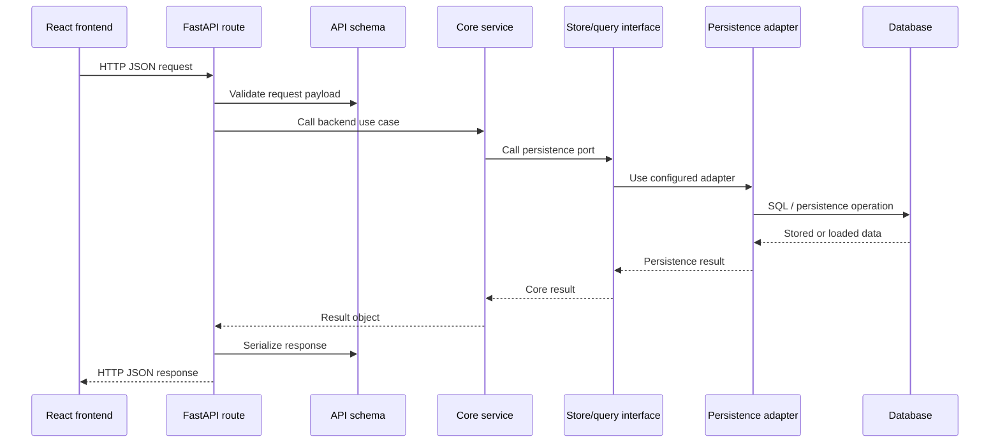

# API Design

## Purpose

This document defines the design plan for the FastAPI API layer.

The API is the HTTP boundary between the React frontend and the reusable Python
backend. It should expose explicit JSON contracts while delegating business
behavior to `src/core`.

## Design Decisions

- Use FastAPI for the initial API implementation.
- Use REST-style JSON endpoints under `/api/v1`.
- Use FastAPI-generated OpenAPI from day one.
- Keep route handlers thin.
- Keep validation, duplicate detection, checksum logic, status transitions, and
  persistence rules in `src/core`.

## API Versioning Policy

The project uses separate version concepts for separate concerns.

```text
Project/package version
  Stored in pyproject.toml.
  Uses semantic versioning, such as 0.1.0, 0.2.0, 1.0.0.

OpenAPI metadata version
  Passed to FastAPI(version=...).
  Shown in /docs and /openapi.json.
  Should follow the project/package version.

HTTP API path version
  Exposed in endpoint paths, such as /api/v1.
  Uses major-only versioning.
```

The API should use major-version URL path versioning:

```text
/api/v1/...
```

Do not use semantic versions in endpoint paths:

```text
/api/v1.2.3/...  # not recommended
```

Reason:

- Python packages benefit from semantic versioning because users install exact
  package releases.
- HTTP clients depend on stable URLs and should not change endpoint paths for
  every patch or minor release.
- A major path prefix such as `/api/v1` gives the project room to introduce a
  future `/api/v2` only when the HTTP contract changes incompatibly.
- The React frontend and future external clients can treat `/api/v1` as the
  stable contract while the package version continues to evolve.

Recommended policy:

```text
Backward-compatible API additions stay under /api/v1.
Breaking HTTP API contract changes require a new major path, such as /api/v2.
The OpenAPI metadata version follows the project release version.
```

Backward-compatible changes include:

```text
adding a new endpoint
adding an optional request field
adding a new response field
adding a new query parameter
fixing a bug without changing the public contract
```

Breaking changes include:

```text
removing an endpoint
renaming an endpoint
removing or renaming a response field
changing a response field type
making an optional request field required
changing enum/status semantics incompatibly
```

The initial API implementation centralizes this in `src/api/settings.py`:

```python
service_name = "biocypher-components-registry"
app_title = "BioCypher Components Registry API"
app_version = "0.1.0"
api_v1_prefix = "/api/v1"
```

`app_version` is application/OpenAPI metadata. `api_v1_prefix` is the
major-versioned HTTP route prefix. Shared backend runtime settings should live
outside the API layer. The API settings module may re-export shared values for
OpenAPI and dependency wiring, but the source of truth for registry database
path settings is `src/core/settings.py`.

Current registry runtime settings:

```text
DATABASE_BACKEND -> explicit sqlite or postgresql selection
SQLITE_DATABASE_PATH -> SQLite file path
POSTGRES_HOST / POSTGRES_PORT / POSTGRES_USER / POSTGRES_PASSWORD / POSTGRES_DB
    -> PostgreSQL connection components
```

Both the API and direct-service CLI use this selection. Initialization supports
fresh databases; historical schema upgrades require a separate migration plan.

Current store construction:

```text
src/api/dependencies.py -> src.persistence.factory.build_registration_store()
```

Docker Compose should set `DATABASE_BACKEND` explicitly. SQLite Compose sets
`SQLITE_DATABASE_PATH` to a path inside a mounted backend volume; PostgreSQL
Compose supplies the database service connection components.

## API Folder Layout

```text
src/api/
├── __init__.py
├── app.py
├── dependencies.py
├── errors.py
├── schemas/
│   ├── __init__.py
│   ├── adapters.py
│   ├── auth.py
│   ├── common.py
│   ├── dataset_uploads.py
│   ├── metadata.py
│   ├── registrations.py
│   ├── registry.py
│   └── workspace.py
└── routers/
    ├── __init__.py
    ├── adapters.py
    ├── auth.py
    ├── dataset_uploads.py
    ├── health.py
    ├── metadata.py
    ├── registrations.py
    ├── registry.py
    ├── schemas.py
    └── workspace.py
```

Responsibilities:

```text
app.py
  FastAPI application factory and router registration.

dependencies.py
  Settings, shared persistence construction, service/query wiring, and
  authenticated GitHub session dependencies.

errors.py
  Mapping from core exceptions to HTTP errors.

schemas/
  Pydantic request and response models for HTTP JSON contracts.

routers/
  Thin FastAPI router modules grouped by workflow or resource.
```

## Request Flow



## Current Endpoint Scope

Health:

```text
GET /api/v1/health
```

Browser authentication:

```text
GET /api/v1/auth/me
POST /api/v1/auth/logout
```

The GitHub OAuth start and callback redirects are implemented but intentionally
use `include_in_schema=False`, so they do not appear in Swagger/OpenAPI.

Registration workflow:

```text
POST /api/v1/registrations
POST /api/v1/registrations/stream
GET /api/v1/registrations
GET /api/v1/registrations/croissant-file-present-check
GET /api/v1/registrations/{registration_id}
GET /api/v1/registrations/{registration_id}/events
POST /api/v1/adapters/{adapter_id}/update
GET /api/v1/schemas/{version}
```

Registry reads:

```text
GET /api/v1/registry/registrations
GET /api/v1/registry/registrations?latest_event=FETCH_FAILED
GET /api/v1/registry/refreshes/latest
GET /api/v1/registry/entries
GET /api/v1/registry/entries/{entry_id}
```

The process, revalidation and HTTP batch-trigger endpoints were removed. Use
`register` for a new or corrected first submission, owner-authorized Update for
a published adapter, and trusted CLI `refresh-registry` for batch maintenance.

Adapter discovery and metadata reads:

```text
GET /api/v1/adapters
GET /api/v1/adapters/latest
GET /api/v1/adapters/search
GET /api/v1/adapters/{adapter_id}
DELETE /api/v1/adapters/{adapter_id}
POST /api/v1/adapters/{adapter_id}/endorse
GET /api/v1/adapters/{adapter_id}/metadata
```

Metadata utilities retain their separate generation/validation boundary:

```text
POST /api/v1/metadata/validate
POST /api/v1/metadata/adapters/generate
POST /api/v1/metadata/datasets/generate
POST /api/v1/metadata/upload-sessions
PUT /api/v1/metadata/upload-sessions/{session_id}/artifacts/{entry_id}
POST /api/v1/metadata/upload-sessions/{session_id}/finalize
GET /api/v1/metadata/upload-sessions/{session_id}
DELETE /api/v1/metadata/upload-sessions/{session_id}
```

The runtime OpenAPI document is authoritative for exact request and response
schemas. The registry path prefix remains `/api/v1`; this branch intentionally
replaces the earlier staged registration contract under that prefix. Consumers
must update their generated contracts together with the backend.

### Inspecting the generated contract

Run the application and open the generated documentation:

```bash
uv run uvicorn src.api.app:app --host 0.0.0.0 --port 8000
```

```text
Swagger UI:   http://localhost:8000/docs
ReDoc:        http://localhost:8000/redoc
OpenAPI JSON: http://localhost:8000/openapi.json
```

Swagger UI is the primary human-readable reference for the current contract.
For each operation it shows parameters, request bodies, response/status models,
examples, and the component schemas generated from Pydantic. **Try it out** sends
requests to the running service and therefore may persist changes in its
configured database; use a development database for mutation testing.

Authentication requirements still apply. GitHub-protected operations need the
normal browser session cookie. OAuth start/callback routes are intentionally
hidden with `include_in_schema=False`. Optional workspace routes are present
only when that router is enabled while OpenAPI is generated.

When reviewing an API route or schema change:

1. Inspect `app.openapi()` or `/openapi.json` from the changed application.
2. Check the affected operation and component schemas in `/docs`.
3. Regenerate the frontend contract with `cd frontend && pnpm run openapi-ts`.
4. Review the generated OpenAPI and TypeScript diffs with the backend change.
5. Update prose only where behavior, workflow, or architecture changed; do not
   manually redefine generated schemas.

## Interface Parity

The FastAPI layer and CLI call the same registration services. React consumes
the API. Legacy web references below retain the earlier interface design context;
they are not a separate current registration implementation.

All three interfaces should use the same core registration contract:

```text
FastAPI routes -> RegistrationStore port -> persistence adapter
Legacy web UI  -> RegistrationStore port -> persistence adapter
CLI commands   -> RegistrationStore port -> persistence adapter
```

Current parity rules:

- First registration, manual adapter updates and batch refresh call the shared
  core services. The CLI calls these directly instead of calling HTTP routes.
- Browser publication uses the existing GitHub cookie session; CLI publication
  verifies identity through device authorization and revokes its temporary user
  token before processing. Updates require source ownership.
- Failed first registration returns diagnostics without stored records. Failed
  updates retain accepted metadata and append terminal processing history.
- Registration lists, event history, and registry entry reads should use
  `RegistrationStore` methods instead of direct database table access.
- Metadata generation should validate by default across FastAPI, CLI, config,
  web, and core request objects. Interfaces may expose an explicit opt-out such
  as `validate: false` or `--no-validate`.
- Adapter metadata validation should use the shared registry-level validation
  contract. This includes adapter schema/compliance checks and validation of
  each embedded dataset fragment. API, CLI, web, and registration processing
  should not define separate meanings for "valid adapter metadata".
- The API owns JSON contracts, the web UI owns HTML rendering, and the CLI owns
  terminal presentation. None of those delivery layers should own registration
  status logic or persistence rules.

Current CLI read commands:

```text
list-registrations
show-registration-events
list-registry-entries
show-latest-refresh
```

## Response Model Guidance

API schemas should be separate from database tables. They should describe the
JSON contract needed by clients.

Suggested registration schemas:

```text
RegistrationCreateRequest
RegistrationAttemptResponse
RegistrationCreateResponse (read-side source summary)
RegistrationDetailResponse
RegistrationEventResponse
RegistrationStreamEvent
ValidationCheckResponse
ValidationDetailResponse
```

`RegistrationCreateRequest` should expose only fields that belong to the HTTP
registration contract:

```text
repository_location: string
license_value: optional string
doi: optional string
cff_url: optional string
```

Do not include UI-only confirmation fields in the API contract. For example, a
frontend checkbox confirming that `croissant.jsonld` exists at the repository
root is a client-side workflow guard, not persisted registry state.

Identity and display name derive from metadata; ownership derives from the
verified account. The browser and CLI publish public HTTPS repositories with a
root-level `croissant.jsonld` on the default branch. The shared service/API also
accepts server-local paths for development and integration tests.

`POST /registrations` returns `RegistrationAttemptResponse`. Successful first
acceptance returns `201`; retrieval/validation rejection returns `200` with
`attempt_status: FAILED` and no source, entry or event. A corrected first
registration may retry the same version. An already accepted repository returns
`409`; an ownership violation returns `403`.

Terminal fields include `attempt_status` (`SUCCEEDED` or `FAILED`),
`published_version`, `update_applied`, `message`, optional identifiers and
`reason_code`, plus validation errors, details, checks and profile information.
`RegistrationCreateResponse` and `RegistrationDetailResponse` are read-side
source models; they expose accepted state separately from `latest_attempt`.

`POST /adapters/{adapter_id}/update` requires ownership of all published sources
for the identity. Failed updates retain accepted metadata. Changed metadata must
preserve identity and use a different, unused version label; semantic-version
ordering is not enforced. Unchanged metadata succeeds without replacing the
entry. CLI updates can explicitly force validation of unchanged metadata.

`POST /registrations/stream` emits `snapshot`, `check` and one terminal `result`
or `error`, with heartbeat comments. Authentication fails before the stream
starts; later errors use the event envelope. Processing may complete after a
disconnect, so clients must not automatically reconnect or repeat this POST.
Without a terminal result, display an unconfirmed outcome and inspect the
catalog before another attempt.

Registration checks use `PENDING`, `RUNNING`, `PASSED`, `FAILED` and `NOT_RUN`.
They cover retrieval/JSON, Croissant compliance, adapter schema, semantics and
embedded datasets, with available file positions, JSON paths, requirements and
validator/schema provenance. `GET /schemas/{version}` returns the bundled
adapter schema as `application/schema+json`; unknown versions return `404`.

`GET /api/v1/registrations` must return summary list items only. It should not
include full Croissant metadata, metadata paths, or validation error details.
Clients should request detail, event history, or future metadata-specific
endpoints when they need larger payloads.

`GET /api/v1/registry/entries` must also stay metadata-free. It returns
canonical valid registry entry identifiers and version/profile/checksum details,
not the full stored Croissant document.

Suggested registry schemas:

```text
RegistryRegistrationResponse
RegistryRegistrationListResponse
RegistryRefreshResponse
RegistryRefreshSummaryResponse
RegistryEntryResponse
RegistryEntryListResponse
```

Suggested adapter catalog schemas:

```text
AdapterCatalogItemResponse
AdapterCatalogListResponse
AdapterDetailResponse
AdapterMetadataResponse
AdapterVersionResponse
```

Adapter catalog endpoints are read-only discovery endpoints built from
canonical valid registry entries. Catalog list/detail endpoints should not
return full Croissant metadata. They expose adapter ids, names, versions,
registry entry ids, profile versions, checksums, and timestamps. Adapter detail
includes the registered version list, so a separate
`GET /api/v1/adapters/{adapter_id}/versions` endpoint is intentionally omitted
until pagination or version-specific filtering is needed.

The latest accepted Croissant document is exposed through the dedicated metadata endpoint:

```text
GET /api/v1/adapters/{adapter_id}/metadata
```

Suggested metadata validation schemas:

```text
MetadataValidationRequest
MetadataValidationResponse
MetadataValidationCheckResponse
AdapterEmbeddedDatasetGenerateRequest
AdapterMetadataGenerateRequest
AdapterMetadataGenerateResponse
DatasetMetadataGenerateRequest
DatasetMetadataGenerateResponse
```

`POST /api/v1/metadata/validate` validates an inline metadata document without
storing it. The request accepts `kind` as `auto`, `adapter`, or `dataset`.
Validation failures return `200` with `is_valid: false` and structured errors;
request-shape problems, such as an unsupported kind or undetectable `auto`
metadata type, return `422`. Adapter validation uses the same registry-level
contract as CLI and registration processing, so embedded datasets are validated
as part of the adapter result.

Metadata generation request schemas normalize surrounding whitespace before
calling the core services. Optional blank strings become `null`; blank list
items are removed. Required scalar fields and required list fields, such as
adapter `creators` and `keywords`, must still contain at least one non-blank
value after normalization or the API returns `422`.

`POST /api/v1/metadata/datasets/generate` is a standalone one-file
`multipart/form-data` operation. The required `file` part contains the source
data; optional form fields configure generation. The API copies the upload to a
temporary server path, removes it after the request, and returns the generated
metadata document. The endpoint validates by default and includes the same
structured dataset validation result returned by
`POST /api/v1/metadata/validate`; clients may pass `validate=false` to opt out.
The public form field is `license`, while the internal core request receives it
as `license_value`. Swagger/OpenAPI is authoritative for the complete form
schema.

The React file/folder workflow does not call this endpoint. It uses the
ephemeral upload-session API so the browser can declare, prepare, and upload a
bounded multi-file inventory. Importing an existing Croissant JSON-LD document
is a separate browser-local workflow and does not invoke either generation API.

`POST /api/v1/metadata/adapters/generate` generates adapter Croissant metadata
from one or more existing dataset metadata files and/or generated dataset
inputs. Like dataset generation, the API writes the generated adapter document
to a temporary server location and returns the metadata document in the response.
The request uses the same core fields as `AdapterGenerationRequest`: adapter
identity fields, `dataset_paths`, `generated_datasets`, `creators`, `keywords`,
`generator`, and `dataset_generator`. The public JSON field is `license`; the
internal core request still receives it as `license_value`. The request schema
includes an OpenAPI example that generates an embedded dataset from a local
server-side path, matching the manual Swagger UI verification workflow.

Publication and attempt state:

```text
published_version: accepted metadata version, when present
latest_attempt.attempt_status: SUCCEEDED or FAILED
update_applied: whether a published entry changed in this operation
latest_event_type: terminal persisted event, separate from publication
```

There is no public registration lifecycle `status` field. Current persisted
success events include `VALID_CREATED` and `UNCHANGED`; failure events describe
retrieval, validation, identity and version conflicts. Historical `SUBMITTED`
and `REVALIDATED` names are not emitted by the current publication workflow.

`GET /api/v1/registry/registrations` accepts `latest_event` filtering. It no
longer supports the former `status` filter. Unsupported event values return
`422`. Batch summary reads include `internal_failed` separately from
`fetch_failed`.

## Error Mapping

HTTP mapping for registration and update requests:

```text
missing sign-in                   -> 401
wrong owner                       -> 403
missing adapter/source/schema     -> 404
already accepted repository       -> 409
concurrent registration conflict  -> 409
invalid request shape             -> 422
unexpected backend failure        -> 500
```

A first-registration validation or retrieval rejection is a terminal attempt:

```text
HTTP 200
attempt_status: FAILED
published_version: null
registration_id: null
validation_errors: [...]
```

Accepted first registrations return `201`. Update processing returns a terminal
attempt with the still-published version when a candidate fails. Streaming
requests report errors occurring after response start inside their terminal
event. Neither a check marked `PASSED` nor an HTTP stream opening confirms a
database commit; the final attempt result does.

## Development Plan

1. Inspect existing core service and store surfaces.
2. Add FastAPI, Uvicorn, and API test dependencies.
3. Create `src/api` package and `GET /api/v1/health`.
4. Add dependency wiring for settings, persistence adapters, stores, and
   services.
5. Add registration schemas and routes.
6. Add missing core read/query methods where needed.
7. Add registry source, refresh, and entry routes.
8. Add HTTP error mapping.
9. Add API integration tests.
10. Verify `/openapi.json` and `/docs`.
11. Document local run commands and frontend API base URL.

## Definition Of Done

The first API milestone is complete when:

- FastAPI app runs locally.
- OpenAPI docs are available.
- registration endpoints call existing core services.
- registry operation endpoints expose frontend-ready JSON.
- routes do not contain business rules.
- routes do not query SQLAlchemy tables directly.
- API tests cover main success and error paths.
- local run and test commands are documented.
