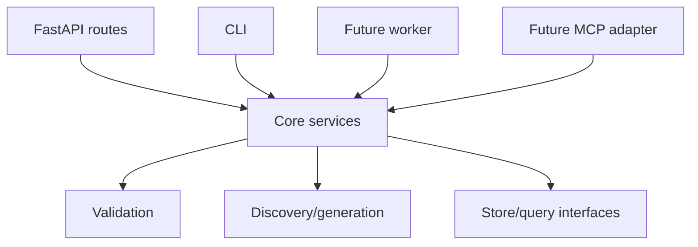

# Core Design

## Purpose

This document describes the intended shape of `src/core`, the reusable backend
application and domain layer.

`src/core` should be independent of FastAPI, React, and deployment mechanics. It
is the source of truth for registry behavior.

Database-specific implementation code belongs in `src/persistence`, not in core
business modules. The registration core defines the persistence ports it needs.
Repository access through Git and GitHub identity checks through HTTPS currently
remain concrete infrastructure dependencies inside core.

## Core Responsibilities

`src/core` owns:

- synchronous adapter registration and owner-authorized updates
- metadata discovery from local or remote repositories
- adapter and dataset metadata generation
- adapter and dataset validation
- duplicate detection
- checksum-based change detection
- canonical registry entry creation
- registration event history
- manual batch refresh and immediate retry/update workflows
- registry read/query behavior for API, CLI, future MCP, and workers

`src/core` must not own:

- HTTP route handling
- Pydantic API response formatting
- React state or UI behavior
- browser/client concerns
- container orchestration
- SQLAlchemy table definitions
- concrete SQLite/PostgreSQL adapter implementations

## Current Core Areas

```text
src/core/adapter/
  adapter metadata generation, discovery, and adapter-specific helpers

src/core/dataset/
  dataset metadata generation, file inference, backend/format selection,
  bounded subprocess execution, and transient browser-upload sessions

src/core/auth/
  shared GitHub identity and device/browser authentication services

src/core/registration/
  registration and update use cases, attempt models, store/query ports, and
  atomic acceptance rules

src/core/schema/
  validation schema resources and active profile loading

src/core/shared/
  shared backend utilities, JSON loading, repository access policy, and constants

src/core/validation/
  adapter and dataset validation logic

src/core/workspace/
  agentic workspace sessions and client-loop services (a separate interface boundary)
```

## Service Boundary

The core should expose use-case functions or service classes that can be called
by multiple delivery adapters.



### Registration service contract

`register_adapter` retrieves and validates a candidate before calling atomic
acceptance. A rejected first attempt has no registration identifier or saved
source, entry or event. Corrected metadata can be submitted again with the same
version.

`update_adapter` checks ownership of every source for the adapter identity and
delegates to `update_registration`. Failed candidates retain published metadata
and append a terminal event. Changed metadata preserves the adapter identity and
requires a different, unused version label; labels need not increase semantically.
Unchanged metadata succeeds without replacing the canonical entry.

`ProcessingOutcome` separates `attempt_status` (`SUCCEEDED` or `FAILED`) from
`published_version` and `update_applied`. Validation checks carry status,
provenance and available source/field diagnostics. These models remain independent
of HTTP and React. Remote repository access uses the configured authority policy
and root metadata from the default branch.

## Query Boundary

The API and future MCP adapter need read/query methods that do not expose
database implementation details.

Likely query capabilities:

```text
get_registration_detail
list_registration_sources
list_registration_events
list_registry_entries
get_registry_entry
get_latest_refresh_summary
search_adapters
```

If a delivery layer needs to assemble data from several tables, prefer adding a
core query method over duplicating that assembly in the delivery layer.

## Persistence Boundary

The application-facing persistence boundary is `RegistrationStore` and related
query/read interfaces.

Detailed persistence adapter guidance is documented in
`sdlc_docs/b_design/backend/persistence_design.md`.

For persistence, the core service layer depends on interfaces. Concrete database
implementations live in `src/persistence` and handle SQLAlchemy, SQLite, and
PostgreSQL details. This abstraction does not currently extend to Git execution
or GitHub identity HTTP calls.

```text
core service -> store/query interface -> src/persistence adapter -> database
```

Current direction:

```text
src/core/registration/
├── service.py
├── store.py
├── models.py
└── errors.py

src/persistence/
├── factory.py
├── schema.py
├── tables.py
├── registration_store_base.py
├── registration_sqlite_store.py
└── registration_postgres_store.py
```

`src/core/registration/store.py` defines what registration workflows need from
persistence. `src/persistence/registration_sqlite_store.py` and the PostgreSQL
implementation define how that port is fulfilled.

## Delivery Layers

Current registration uses the React/FastAPI boundary, while the CLI calls the
same core services directly. There is no `src/core/web` server-rendered delivery
layer. The agentic workspace is a separate delivery concern and does not define
registration behavior. New reusable behavior belongs in core services or query
ports rather than React components, route handlers, or CLI presentation code.
