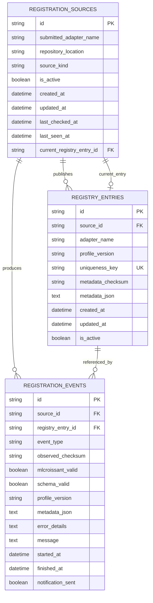
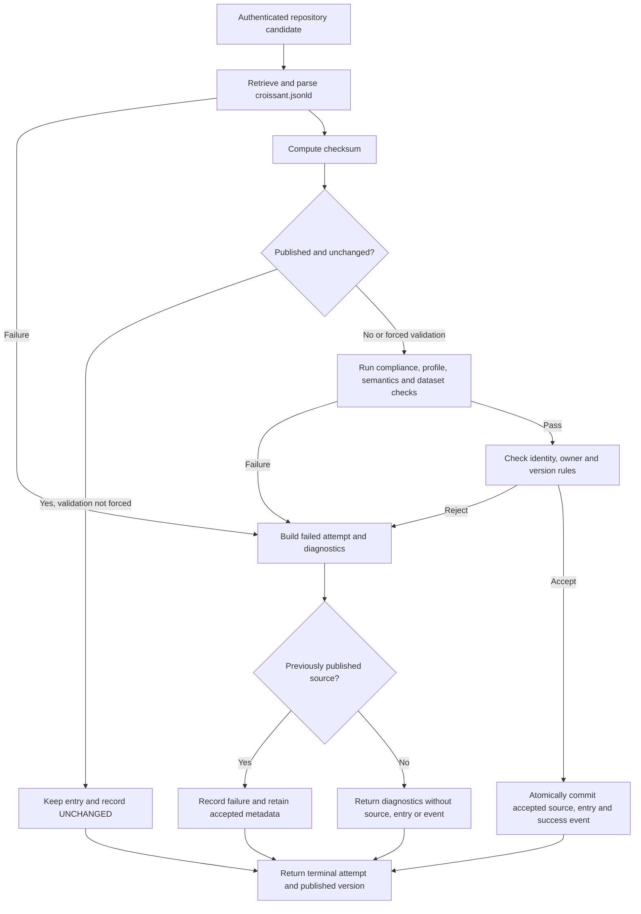

# Registration Database Design

## Purpose

This document defines the database design and registration publication workflow for the BioCypher components registry.

This document describes the database schema and persistence rules. Python code
that communicates with the database should live under `src/persistence`, while
business rules and persistence ports remain in `src/core`.

For Python persistence adapter structure, see
`sdlc_docs/b_design/backend/persistence_design.md`.

The design supports:

- repository submissions from users
- periodic retrieval of `croissant.jsonld`
- validation through:
  - `mlcroissant` compliance
  - registry schema/profile validation
- canonical storage of valid registry entries
- history tracking for accepted registrations and subsequent update attempts
- duplicate detection
- change detection using checksums

## Design Goals

The database system should:

- separate canonical valid entries from processing history
- retain terminal update outcomes while returning rejected first attempts without records
- avoid silently replacing canonical entries with changed content for the same version
- detect unchanged files efficiently using checksums
- preserve the same acceptance contract for SQLite and PostgreSQL

## Core Rules

### Validation gates

A `croissant.jsonld` file becomes a canonical registry entry only if it passes:

1. `mlcroissant` validation
2. registry schema/profile validation

If either validation fails:

- the canonical valid entry must remain unchanged
- a published source records the failed update in history
- a failed first registration returns errors without creating a source or event
- notifications remain future work

### Duplicate policy

The canonical uniqueness key is:

```text
adapter_id + "::" + version
```

Examples:

- `omnipath-adapter::1.0.0`
- `clinical-knowledge-adapter::2.1.0`

Why `adapter_id` instead of `adapter_name`:

- `adapter_id` is normalized and stable
- it avoids duplicate misses caused by spaces, capitalization, or minor naming variants
- names like `OmniPath Adapter`, `Omnipath adapter`, and `omnipath adapter` resolve to the same adapter identity

Only one canonical valid entry may exist for a given uniqueness key. Repository
locations are also unique after normalization. Missing metadata `@id` falls back
to the metadata name consistently across registration, reads and updates.

The submitting GitHub identity owns its source. Updates require ownership of
every published source for that adapter identity. Acceptance checks identity
ownership within the write transaction, preventing competing accounts from
claiming different versions of the same identity.

### Change detection policy

The system computes a checksum of normalized metadata JSON from the retrieved `croissant.jsonld`.

If the checksum is unchanged:

- the system records the event as `UNCHANGED`
- the canonical registry entry is not modified

If the checksum changed:

- the system runs validation
- the system decides whether to create, reject, or preserve the existing entry

### Same version, changed file

If the file changed but still uses the same `adapter_id + version`, the recommended policy is:

- do not silently replace the canonical valid entry
- reject the update
- require a different, unused version label; semantic-version ordering is not enforced

This preserves reproducibility and avoids silently changing the meaning of an already published adapter version.

## Proposed Tables

Registration uses **three core tables**, described below. The separate
`registry_refreshes` table stores batch summaries; authentication and endorsement
tables retain their existing responsibilities.

## Table 1: `registration_sources`

This table stores the repositories or local sources that the system watches.

Suggested columns:

- `id`
- `submitted_adapter_name`
- `description`
- `license_value`, `doi`, `cff_url`
- `submitted_by_github_user_id`
- `repository_location` (unique)
- `source_kind`
- `is_active`
- `created_at`
- `updated_at`
- `last_checked_at`
- `last_seen_at`
- `current_registry_entry_id`

Purpose:

- track what the system should poll or process
- connect a source to its latest accepted canonical registry entry

## Table 2: `registry_entries`

This table stores only canonical valid registry entries.

Suggested columns:

- `id`
- `source_id`
- `adapter_name`
- `profile_version`
- `uniqueness_key`
- `metadata_checksum`
- `metadata_json`
- `created_at`
- `updated_at`
- `is_active`

Constraints:

- unique on `uniqueness_key`

Purpose:

- represent the valid registry that downstream consumers query

## Table 3: `registration_events`

This table stores accepted first registrations and subsequent terminal update attempts.

Suggested columns:

- `id`
- `source_id`
- `registry_entry_id`
- `event_type`
- `observed_checksum`
- `mlcroissant_valid`
- `schema_valid`
- `profile_version`
- `metadata_json`
- `error_details`
- `message`
- `started_at`
- `finished_at`
- `notification_sent`

Purpose:

- provide an append-only audit trail
- support debugging, reporting and future operational integrations

## Recommended Event Types

Current success events include:

- `VALID_CREATED`
- `UNCHANGED`

Failed updates record retrieval/validation reasons or conflicts, including
`FETCH_FAILED`, `INVALID_JSON`, `INVALID_MLCROISSANT`, `INVALID_SCHEMA`,
`REJECTED_SAME_VERSION_CHANGED`, `DUPLICATE` and `ADAPTER_ID_CHANGED`.
Other retrieval and semantic reason codes can also appear; readers should
preserve unknown event names when displaying history.

Historical `SUBMITTED` and `REVALIDATED` values are not emitted by the current
workflow. Events describe attempts, not registration lifecycle status.
First-registration rejections create no event. Public attempt responses use
`SUCCEEDED` or `FAILED` separately from `published_version`.

## Conceptual Relationship Diagram



The relationships above are logical store-managed references; the current
SQLAlchemy tables do not declare foreign-key constraints. An accepted source
can have multiple historical entries; `current_registry_entry_id` selects its
current accepted metadata. Version is read from `metadata_json`, not a separate
`adapter_version` column.

## Registration Lifecycle

The user-facing registration flow is:

1. authenticate the submitting GitHub identity
2. normalize the repository source and reject an already accepted repository
3. retrieve current root metadata from its default branch (or a local source)
4. parse JSON, compute the checksum and validate all required stages
5. enforce canonical identity/version uniqueness and ownership
6. commit source, canonical entry, current-entry pointer and `VALID_CREATED`
   event in one transaction
7. return the terminal result after persistence

Rejected first attempts return actionable diagnostics and create no records.
Corrected first attempts may reuse the same version. Published updates instead
retain accepted metadata on failure and append their terminal history.

## Registration Process Flow



Acceptance handles uniqueness and ownership races inside the transaction. A
streamed progress check is not confirmation of publication; only the terminal
result follows persistence.

## Decision Rules

### Case 1: retrieved file is unchanged

Behavior:

- store `UNCHANGED` event
- do not modify canonical registry

### Case 2: file changed and both validations pass

If `adapter_id + version` is new:

- create a new canonical registry entry

If `adapter_id + version` already exists:

- reject the update
- require a version bump

### Case 3: file changed and one or both validations fail

Behavior:

- store invalid event
- keep the existing valid entry unchanged
- expose the failed update in history; notification delivery is future work

### Case 4: new entry

Behavior:

- validate
- if valid, create canonical entry
- if invalid or otherwise rejected, return diagnostics without records
- if valid and accepted, commit source, entry and success event atomically

## Recommended Operational Behavior

### Polling

Manual CLI `refresh-registry` iterates active published sources. Each source
is processed independently and one failure does not stop the batch. Scheduling,
retry backoff and notification delivery are not implemented.

For each source:

- fetch current `croissant.jsonld`
- compute checksum
- compare with latest known checksum
- decide whether to process or skip

### Notifications

Future notifications would be useful for:

- failed validation after file changed
- repeated fetch failures
- changed valid file with same version

Notifications are not needed for:

- unchanged file
- normal successful checks

## Why This Design Is Recommended

This design is suitable because it:

- protects the canonical registry from invalid updates
- retains accepted publication history and subsequent terminal update attempts
- supports professional traceability and reproducibility
- uses checksum-driven polling to avoid unnecessary work
- maps well to SQLAlchemy Core and later PostgreSQL migration

## Migration Notes

SQLite and PostgreSQL share SQLAlchemy tables and the same registration store
contract. Initialization creates the current schema for fresh databases under
startup locking; it does not migrate historical schemas automatically.

An existing deployment needs an explicit migration/export plan before upgrading.
Preserve atomic acceptance, canonical uniqueness, owner identity, checksums,
current-entry pointers and event history across any such migration.

Manual batch refreshes persist identifiers, timestamps and counters in
`registry_refreshes`: `active_sources`, `processed`, `valid_created`, `unchanged`,
`invalid`, `duplicate`, `rejected_same_version_changed`, `fetch_failed` and
`internal_failed`. The API exposes only the latest summary for reading.

Tests use temporary SQLite databases and isolated schemas in a specifically
labeled disposable PostgreSQL container. They do not target a developer's live
application database.
