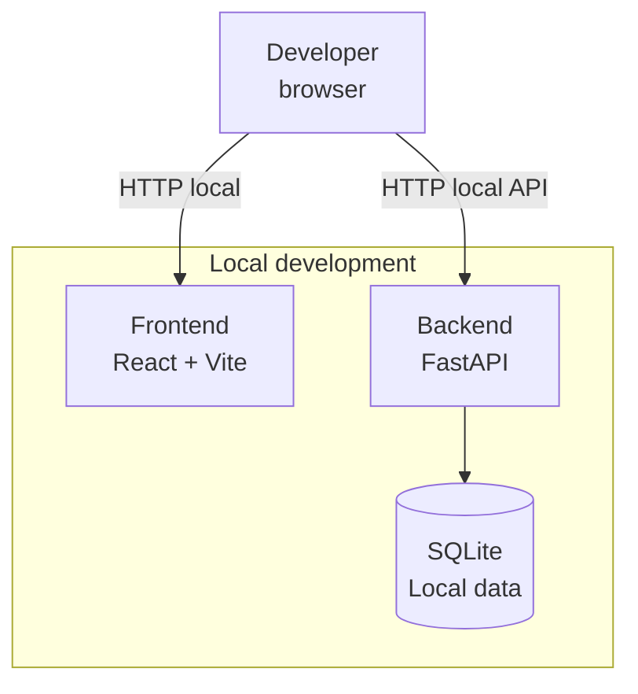
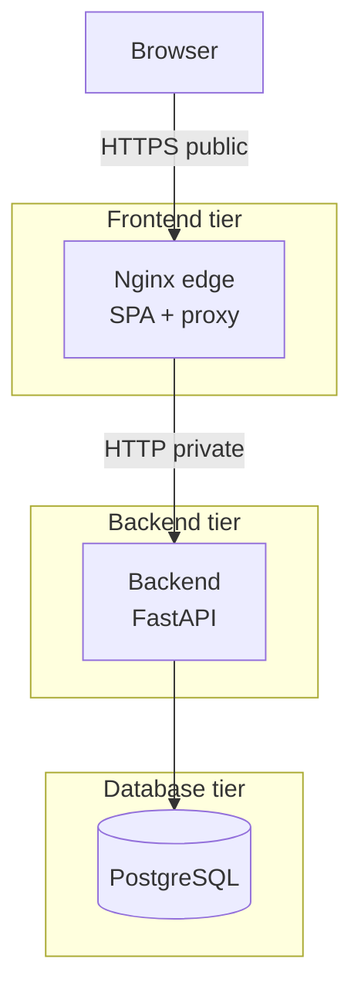

# Deployment Design

## Purpose

This document defines the deployment direction for the BioCypher Components
Registry.

The project starts as a single repository during development and should evolve
toward a three-tier production architecture:

- frontend
- backend
- database

Docker Compose should be used to make local multi-service development
repeatable.

## Transport Conventions

“HTTP API” names the application interface. The concrete transport depends on
the deployment boundary:

| Connection | Transport | Exposure |
| --- | --- | --- |
| Browser to Vite or Uvicorn during local development | HTTP | Localhost only |
| Browser to the production edge | HTTPS | Public network |
| Nginx edge to FastAPI | HTTP | Private container network |
| Backend to GitHub or a remote Git host | HTTPS | External network |

Public TLS terminates at Nginx. React executes in the browser; the frontend
container serves its static assets and proxies browser API requests rather than
making those requests as a separate application server.

The three URL settings describe two network boundaries:

| Setting | Boundary | Development example | Production example |
| --- | --- | --- | --- |
| `FRONTEND_BASE_URL` | Browser-facing site origin used for redirects and CORS | `http://localhost:5173` | `https://registry.biocypher.org` |
| `VITE_API_BASE_URL` | Browser-reachable API origin used by React and OAuth callbacks | `http://localhost:8000` | `https://registry.biocypher.org` |
| `BACKEND_INTERNAL_URL` | Private Nginx-to-FastAPI address | `http://backend:8000` | `http://backend:8000` |

The first two settings differ in local development because Vite and FastAPI
listen on separate ports. They normally share the public Nginx origin in
production. This does not expose the FastAPI service directly: the browser can
reach only the paths that Nginx proxies to the private backend address.

## Development Architecture

During development, this repository contains both frontend and backend code.

```text
biocypher-components-registry/
├── frontend/
├── src/
│   ├── api/
│   ├── core/
│   └── persistence/
├── tests/
└── sdlc_docs/
```

The development stack can run as local processes or through Docker Compose. For
early development, it can be treated as one development tier because all code
lives in one repository and SQLite does not require a separate database runtime.
React code in the browser calls the backend through the `/api/v1` JSON API. The
backend contains `src/api`, `src/core`, and `src/persistence` in the same
process.



Recommended development services:

```text
frontend
backend
db, only when developing against PostgreSQL
```

With SQLite, a separate database container is not needed.

Current development Compose implementation:

```text
backend
  FastAPI application plus src/core and src/persistence.
  Persists /app/data/registry.sqlite3 in the biocypher-sqlite-data named volume.
```

Run the current development backend container:

```bash
docker compose -f docker-compose-sqlite.yml up --build backend
```

Verify the containerized backend:

```bash
http GET :8000/api/v1/health
```

The backend container uses:

```text
DATABASE_BACKEND=sqlite
SQLITE_DATABASE_PATH=/app/data/registry.sqlite3
```

The `biocypher-sqlite-data` volume mounted at `/app/data` keeps the development
SQLite file outside the container lifecycle. This is only the current development
runtime shape; it does not imply that SQLite is the production database.

## Production Architecture

Production should use a three-tier architecture.

> **Status of `docker-compose.prod.yml`:** despite its filename, this file is an
> experimental developer deployment that currently combines the backend with a
> persistent SQLite volume. It is useful for testing the built images, Nginx,
> TLS, and Certbot integration, but it is not the reference production topology
> described in this section. Production-oriented deployments should use the
> separate PostgreSQL data tier shown below.



Nginx serves the React build and proxies same-origin `/api` requests to FastAPI
over the private container network. FastAPI reuses `src/core` in-process and
includes the `src/persistence` adapters. The production database should be
PostgreSQL or a managed PostgreSQL-compatible service.

The current Nginx configuration proxies `/api/` and `/agent/api/` when the
optional workspace is enabled. It does not proxy FastAPI's `/docs`, `/redoc`, or
`/openapi.json` paths, so those documentation interfaces remain local or
development-only unless a future deployment decision exposes them explicitly.

A separately hosted frontend is an alternative topology, not the diagrammed
baseline. It requires an explicit CORS, cookie, CSRF, and TLS design.

## Docker Compose Direction

Current Compose files separate the application and test databases:

```text
docker-compose-sqlite.yml
  backend and frontend; named SQLite volume
docker-compose-postgresql.yml
  backend, frontend and database; PostgreSQL application database
docker-compose.test.yml
  disposable labeled PostgreSQL database for tests
docker-compose.prod.yml
  experimental image/TLS deployment; currently SQLite-backed, not the reference
  production topology
```

The conceptual services below remain the deployment boundary; the current
PostgreSQL Compose service is named `database`.

The Python service should be named `backend`, not `api`, because it contains
the FastAPI delivery layer, core business logic, and persistence adapter code.

Conceptual Compose services:

```text
frontend
  React/Vite dev server or built static frontend.

backend
  FastAPI application plus src/core and src/persistence.

db
  PostgreSQL. Optional while SQLite is used for local development.
```

The `db` service is the database runtime. It is separate from the
`src/persistence` Python package, which is database communication code inside
the backend image.

Future services may include:

```text
worker
  Scheduled polling or batch refresh runner using the backend image.

mcp
  Future MCP delivery adapter using backend/core read services.
```

## Environment Variables

Registry database configuration:

```text
DATABASE_BACKEND
SQLITE_DATABASE_PATH
POSTGRES_HOST
POSTGRES_PORT
POSTGRES_USER
POSTGRES_PASSWORD
POSTGRES_DB
```

`DATABASE_BACKEND` explicitly selects `sqlite` or `postgresql`. SQLite requires
`SQLITE_DATABASE_PATH`. PostgreSQL uses the `POSTGRES_*` component configuration;
a password is required. The application Compose files set the backend and
container-specific host or path explicitly.

The application Compose files explicitly select their own database settings.
For a CLI running on the host, use the database's published host/port rather
than the container-internal `database` hostname. API and CLI use the same factory;
the CLI does not require a running API.

Publication authentication and repository policy:

```text
GITHUB_OAUTH_CLIENT_ID
GITHUB_OAUTH_CLIENT_SECRET
AUTH_SESSION_SECRET
FRONTEND_BASE_URL
VITE_API_BASE_URL
BACKEND_INTERNAL_URL
REGISTRY_ALLOWED_REPOSITORY_HOSTS
```

`FRONTEND_BASE_URL` and `VITE_API_BASE_URL` are browser-facing origins.
`BACKEND_INTERNAL_URL` belongs to the frontend/Nginx container and identifies
the private upstream FastAPI service; browser code must never use the Docker
hostname from that setting.

The browser keeps its existing OAuth session flow. CLI publication requires the
OAuth app's device flow and revokes the temporary user token after verification.
Do not persist that token in application configuration. Repository authorities
default to GitHub and GitLab; self-hosted authorities require explicit approval.

SQLite paths and database URLs should not be hardcoded in API route handlers.

## Data Persistence

SQLite is acceptable for simple local development and early milestones. It
should use a stable local path or Docker volume when run in containers.

PostgreSQL should be used for production-oriented deployments and for local
development once database migration behavior needs to be exercised.

### PostgreSQL verification environment

```bash
docker compose -f docker-compose.test.yml up -d --wait database
REGISTRY_TEST_POSTGRES_CONTAINER=biocypher-registry-test-database uv run pytest -ra
docker compose -f docker-compose.test.yml down
```

This database uses disposable storage and a test-only label. Tests create isolated
schemas; they do not use the application's database URL. PostgreSQL cases skip
when the test container is unavailable, while configuration or database failures
remain errors. CI provisions the equivalent PostgreSQL 16 service.

Registry schema initialization supports fresh SQLite/PostgreSQL databases only.
An existing schema needs a separately planned migration; there is no automatic
historical upgrade. Batch refresh is manual CLI maintenance; the worker above
remains a future deployment option.

## Open Decisions

- Whether production PostgreSQL is self-hosted through Compose or managed.
- Whether the production frontend is served by a container or static hosting.
- When to introduce a separate worker service.
- When to introduce an MCP service.
- Which administrator authorization protects future global maintenance APIs; publication already uses GitHub identity.
