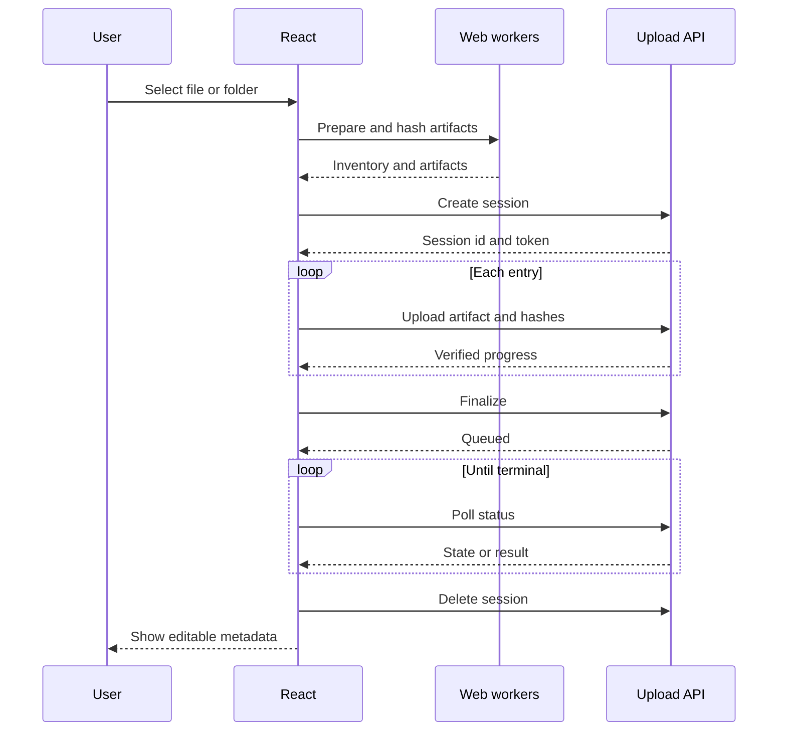

# Frontend API Contract

## Purpose

This document defines how the implemented React frontend consumes the FastAPI
API and which contracts new screens must preserve.

It is a screen-by-screen contract for frontend implementation. It does not
replace the OpenAPI schema; it explains which endpoints each screen needs, what
fields the UI should rely on, and which states the frontend should handle.

The frontend should treat the backend as the source of truth for:

- metadata validation
- repository discovery
- registration publication and attempt outcomes
- duplicate detection
- checksum/change detection
- persistence

The frontend may perform lightweight user-experience validation, but it must not
reimplement backend business rules.

## API Base

Development API base:

```text
http://127.0.0.1:8000
```

Current API prefix:

```text
/api/v1
```

Frontend clients should centralize this value in one configuration point:

```text
VITE_API_BASE_URL=http://127.0.0.1:8000
```

Do not hardcode `/api/v1` across individual components.

## API Client Direction

The frontend should use dedicated API-client functions instead of raw `fetch`
calls scattered through page components.

Registration uses the generated client in `frontend/src/api/client/` and the
stream wrapper in `frontend/src/api/registration.ts`. Regenerate the contract
with `pnpm run openapi-ts` when API schemas change. The wrapper consumes progress
events without automatically retrying the publication POST.

The original suggested module separation remains:

```text
frontend/src/api/client.ts
frontend/src/api/registrations.ts
frontend/src/api/registry.ts
frontend/src/api/adapters.ts
frontend/src/api/metadata.ts
```

Recommended response handling:

```text
2xx
  Parse JSON and return typed data.

400
  Backend rejected a validly shaped request during processing.
  Display detail as an operation error.

401
  Sign-in is required for publication.

403
  The current account does not own the source/adapter being modified.

409
  Repository already registered or a concurrent change prevented acceptance.

404
  Requested registration, registry entry, adapter, or refresh does not exist.
  Display a not-found state.

422
  Request validation failed before operation execution.
  Map field errors to the form when possible.

5xx
  Display a generic backend failure message.
```

## Screen To Endpoint Map

| Frontend Screen | Endpoint(s) | Purpose |
| --- | --- | --- |
| Health/dev status | `GET /api/v1/health` | Confirm backend availability during development. |
| Registration form | `POST /api/v1/registrations/stream` (or JSON `POST /api/v1/registrations`) | Validate and accept one repository in a single operation. |
| Registration detail | `GET /api/v1/registrations/{registration_id}` | Show accepted metadata, published version and latest attempt. |
| Registration events | `GET /api/v1/registrations/{registration_id}/events` | Show event history/timeline. |
| Adapter update | `POST /api/v1/adapters/{adapter_id}/update` | Owner-authorized refresh of a published adapter. |
| Validation schema | `GET /api/v1/schemas/{version}` | Read the exact deployed adapter schema. |
| Registry operations | `GET /api/v1/registry/registrations`, `GET /api/v1/registry/refreshes/latest` | Read published source/attempt state and the last CLI batch summary. |
| Registry entries | `GET /api/v1/registry/entries`, `GET /api/v1/registry/entries/{entry_id}` | Maintainer canonical entry inspection. |
| Adapter catalog | `GET /api/v1/adapters` | Public list of valid adapters. |
| Adapter detail | `GET /api/v1/adapters/{adapter_id}` | Public detail for one adapter and its versions. |
| Adapter metadata | `GET /api/v1/adapters/{adapter_id}/metadata` | Latest accepted Croissant metadata for one adapter. |
| Metadata validation | `POST /api/v1/metadata/validate` | Validate inline adapter or dataset metadata. |
| Dataset metadata generation | `POST /api/v1/metadata/datasets/generate` | Generate dataset Croissant metadata from one multipart file upload. |
| Browser dataset generation | `POST /api/v1/metadata/upload-sessions`, artifact `PUT`, finalize `POST`, status `GET`, session `DELETE` | Prepare a selected file/folder in the browser and generate without persistent upload storage. |
| Adapter metadata generation | `POST /api/v1/metadata/adapters/generate` | Generate adapter metadata with existing or generated datasets. |

## Shared Types

### Registration Attempt Status

Terminal attempts use:

```text
SUCCEEDED
FAILED
```

Keep this separate from `published_version`, `update_applied` and
`latest_event_type`. A failed update can coexist with a valid published version.
There is no registration lifecycle `status` field.

Active request states (processing/retrying) are local UI state. A disconnected
request without a final result is **Unconfirmed**; it is not proof that the
server rejected or rolled back publication.

### Registration Event Types

Persisted success events include `VALID_CREATED` and `UNCHANGED`. Failure names
describe retrieval, validation, identity or version conflicts, for example
`FETCH_FAILED`, `INVALID_JSON`, `INVALID_SCHEMA`, `INVALID_MLCROISSANT`,
`REJECTED_SAME_VERSION_CHANGED`, `DUPLICATE` and `ADAPTER_ID_CHANGED`.

First-registration failures create no event. Historical names such as
`SUBMITTED` and `REVALIDATED` are not emitted by the current workflow. Event
rendering must preserve unknown names instead of assuming a closed enum.

### Validation Result

Validation responses include:

```text
kind
is_valid
profile_version
errors
checks[]
```

Each check includes:

```text
name
is_valid
errors
```

Use `is_valid` for the summary state. Use `checks` for detailed diagnostic UI.

## Registration Form

The current registration page uses `POST /api/v1/registrations/stream`; JSON
clients can use `POST /api/v1/registrations`. Both call the same core operation
and require the existing signed-in GitHub cookie session.

Request fields:

| Field | Required | Notes |
| --- | --- | --- |
| `repository_location` | Yes | Browser publishing uses a public HTTPS repository with root-level metadata on its default branch. |
| `license_value` | No | Optional submitted license text. |
| `doi` | No | Optional DOI. |
| `cff_url` | No | Optional Citation File Format URL. |

Name and adapter identity derive from the metadata; owner identity derives from
the authenticated account. `confirm_croissant_root` remains UI-only state.

The form checks `GET /api/v1/registrations/croissant-file-present-check` before
submission. Repository changes invalidate earlier preflight results. A passing
preflight does not guarantee acceptance because registration retrieves fresh
metadata and applies all validation and ownership rules.

Terminal response fields used by the UI:

```text
attempt_status
registration_id / adapter_id / adapter_name / repository_location (when accepted)
published_version
update_applied
reason_code
message
validation_errors
validation_details
validation_checks
profile_version
```

Successful first acceptance returns JSON `201`, or an SSE terminal `result`
after the atomic commit. A rejected first candidate returns a terminal `FAILED`
attempt without a persisted source, entry or event; a corrected submission may
retry the same version. JSON processing failures normally use HTTP `200`.

Stream handling:

| Event | UI behavior |
| --- | --- |
| `snapshot` | Initialize ordered validation checks. |
| `check` | Replace/add the matching check by ID. |
| `result` | Render the terminal attempt and published version. |
| `error` | Render the reported request/processing error. |

Heartbeat comments carry no result. Render file/JSON, Croissant, adapter profile,
semantic and per-dataset checks separately. Check states are `PENDING`, `RUNNING`,
`PASSED`, `FAILED` and `NOT_RUN`; these are distinct from terminal attempt status.
Show available file positions, JSON paths, requirements and expected formats.
The schema viewer loads `GET /api/v1/schemas/{version}` and displays the applied
schema/validator provenance. Do not invent missing diagnostic positions.

A stream opening or a passed check does not confirm persistence. If the
connection ends without a terminal result, display **Unconfirmed** and direct
the user to inspect the adapter catalog before retrying. The service may have
completed after disconnect; never automatically reconnect or repeat this POST.

Handle `401` with sign-in feedback, `403` as an ownership rejection, `409` as an
already accepted repository/concurrent conflict, and `422` as request validation
errors. The JSON API also accepts server-local paths for development; see the
[manual verification guide](../../c_verification/api_manual_verification.md)
for an authenticated HTTPie example.

## Registration Detail

Read endpoints:

```text
GET /api/v1/registrations/{registration_id}
GET /api/v1/registrations/{registration_id}/events
```

Detail fields include source identifiers and normalized repository details,
`published_version`, `latest_attempt`, timestamps, `metadata`, `metadata_path`,
`profile_version`, `uniqueness_key` and validation errors. Event fields retain
their source/entry identifiers, event type, message, profile/errors, checksum,
validation outcomes and start/finish timestamps.

Primary UI regions remain source information, accepted metadata, latest attempt
diagnostics and event history. Present the accepted version separately from the
latest failed candidate; a failed update does not unpublish accepted metadata.

Published adapter detail exposes `can_update` and `can_delete` from the backend.
Only the owner can invoke `POST /api/v1/adapters/{adapter_id}/update`. This
replaces the former process/revalidation actions. After an update, refresh
accepted detail and history; use the returned attempt to show diagnostics.

- Unchanged metadata succeeds without replacing the entry.
- Changed metadata must preserve identity and use a different, unused label.
  Semantic-version ordering is not enforced.
- Failed updates retain the accepted version and append terminal history.
- Rejected first registrations are corrected and resubmitted through the form;
  there is no failed-source detail record to revalidate.

Keep loading and not-found states explicit. Missing historical events should
produce a neutral empty timeline, and rejected actions should display the
backend error before refreshing accepted state.

## Registry Operations

The registry read boundary remains:

```text
GET /api/v1/registry/registrations
GET /api/v1/registry/registrations?latest_event=FETCH_FAILED
GET /api/v1/registry/refreshes/latest
GET /api/v1/registry/entries
```

Overview rows expose `registration_id`, `adapter_name`, `adapter_id`, repository
kind/location, `published_version`, `latest_attempt`, `latest_event_type`,
timestamps, profile and uniqueness information. Lists omit full Croissant
metadata. The former lifecycle `status` field/filter is removed; `latest_event`
accepts strict supported values and invalid values return `422`.

Batch refresh is a trusted CLI `refresh-registry` operation. There is no HTTP
batch-trigger route or browser batch button in this implementation. The read-only
latest-summary response contains:

```text
refresh_id
started_at
finished_at
active_sources
processed
valid_created
unchanged
invalid
duplicate
rejected_same_version_changed
fetch_failed
internal_failed
```

Retain clear empty states: no published sources links back to registration;
`404` for the latest summary means no batch has completed. A failed background
read should keep the previous accepted data visible with an operation error.

## Adapter Catalog

Primary route suggestion:

```text
/adapters
```

Endpoint:

```text
GET /api/v1/adapters
```

Catalog item fields:

```text
adapter_id
adapter_name
latest_version
version_count
```

Important behavior:

- Only canonical valid registry entries appear in the adapter catalog.
- Rejected first candidates never appear. Published adapters remain visible after a failed update.
- This is a public read model, not a maintainer operations table.

Empty state:

- If `items` is empty, show "No valid adapters are registered yet."

## Adapter Detail

Primary route suggestion:

```text
/adapters/:adapterId
```

Endpoints:

```text
GET /api/v1/adapters/{adapter_id}
GET /api/v1/adapters/{adapter_id}/metadata
```

Detail fields:

```text
adapter_id
adapter_name
latest_version
versions[]
```

Version fields:

```text
adapter_id
adapter_name
adapter_version derived from metadata.version
registry_entry_id
profile_version
metadata_checksum
created_at
updated_at
```

Metadata response fields:

```text
adapter_id
adapter_version derived from metadata.version
registry_entry_id
metadata
```

UI behavior:

- Show registered versions and the latest attempt separately.
- Make the published version visually clear.
- Fetch full accepted metadata only when the user opens a metadata
  panel. Do not fetch full metadata for the catalog list.
- Render metadata in a readable JSON viewer or structured summary.

Error states:

- `404` adapter not found.
- Missing metadata uses the backend not-found response.

## Metadata Workspace

Primary route suggestion:

```text
/metadata
```

The workspace supports two independent browser workflows:

- **Generate from source data:** the user selects one data file or a folder. The
  browser prepares bounded artifacts and uses ephemeral upload sessions to
  generate dataset Croissant metadata.
- **Import existing metadata:** the user selects a dataset Croissant JSON-LD
  file. The browser parses it locally and populates the editable fields without
  creating an upload session.

Both workflows produce an editable dataset draft and converge only when the
frontend sends dataset documents for final adapter generation. UI copy must not
present a browser-local path as a server path or imply that uploaded data is
persistent.

### Validate Metadata

Endpoint:

```text
POST /api/v1/metadata/validate
```

Request fields:

```text
metadata
kind
```

Allowed `kind` values:

```text
auto
adapter
dataset
```

UI behavior:

- Provide a JSON editor or upload/paste flow.
- Default to `auto`.
- Show validation summary and per-check details.
- If auto-detection fails, ask the user to choose adapter or dataset.

### Generate Dataset Metadata

Endpoint:

```text
POST /api/v1/metadata/datasets/generate
```

Request fields:

```text
file (required binary upload)
generator
validate
name
description
url
license
citation
content_url
dataset_version
date_published
encoding_format
filename
sha256
creators_json
```

Allowed `generator` values:

```text
auto
croissant-baker
native
```

Default UI behavior:

- `validate` should default to `true`.
- `generator` defaults to `auto`.
- Treat this endpoint as a standalone one-file multipart API operation. The
  React file/folder workflow uses upload sessions instead.

Response fields:

```text
metadata
generator
stdout
stderr
warnings
validation
```

For browser-selected source data, the React application uses the upload-session
protocol for both a single file and a folder. It does not call the standalone
multipart endpoint above. The browser accepts one UTF-8 CSV/TSV file or a folder
of up to 1,000 CSV/TSV files, including `.csv.gz` and `.tsv.gz`. It hashes the
original bytes, uses complete files up to 1 MiB, and prepares complete-row
samples for larger plain files and gzip sources. The declared artifacts are
limited to 1 MiB each and 50 MiB per session.

Importing an existing dataset Croissant file is separate from source-data
generation. The browser reads the JSON-LD document locally, projects supported
properties into the editor, and preserves unrepresented properties. No dataset
upload session or standalone generation request is created for this import.



The frontend keeps the bearer token out of URLs and persistent browser storage.
It treats `429` as admission backpressure and honors `Retry-After`; prepared
artifacts can be retried while their in-memory handles remain available. A lost
backend process loses the session, and reselecting the source may be required.
Cancellation is allowed only before finalization starts. The terminal response
contains generated metadata, selected generator, warnings, and validation.

### Generate Adapter Metadata

Endpoint:

```text
POST /api/v1/metadata/adapters/generate
```

Request fields:

```text
name
description
version
license
code_repository
dataset_paths
generated_datasets
validate
creators
keywords
adapter_id
programming_language
target_product
generator
dataset_generator
```

Generated dataset item fields:

```text
input
validate
name
description
url
license
citation
dataset_version
date_published
creators
extra_args
```

Allowed values:

```text
generator: native
dataset_generator: auto, croissant-baker, native
```

Default UI behavior:

- `validate` should default to `true`.
- `programming_language` should default to `Python`.
- `target_product` should default to `BioCypher`.
- Require at least one creator and one keyword.
- Require at least one existing dataset path or generated dataset.

Response fields:

```text
metadata
generator
dataset_generator
stdout
stderr
warnings
validation
```

## Shared UI State Rules

### Loading

Use loading indicators for:

- initial page data fetch
- registration and owner-authorized update actions
- registry summary reads
- metadata generation
- metadata validation

Disable only the action that is currently running. Avoid freezing the whole
page unless necessary.

### Empty

Use explicit empty states for:

- no registrations
- no events
- no latest refresh
- no valid adapters
- no metadata discovered yet

Empty states should suggest the next useful action.

### Success

Success states should show:

- what changed
- current status
- link to detail view when available

### Errors

For backend errors, prefer this display order:

```text
field-level validation errors
operation-specific error detail
generic fallback message
```

Do not hide backend validation errors behind generic toast messages. They are
important in this project.

## Frontend Implementation Checklist

Before implementing a screen:

- Identify the endpoint(s) from this document.
- Confirm the endpoint works in `/docs` or with HTTPie.
- Define TypeScript types matching the response fields used by the UI.
- Implement one API-client function per backend operation.
- Design loading, empty, success, and error states before adding styling polish.
- Keep backend status values as data, not as frontend business logic.

Before considering a screen complete:

- It handles `400`, `404`, and `422` responses where applicable.
- It does not request full metadata for list/table pages.
- It refreshes accepted state after owned updates and handles unconfirmed registration outcomes.
- It renders unknown event types without crashing.
- It has a manual verification path.

## Deferred Decisions

- Administrator authorization for future global maintenance operations; publication already requires GitHub identity.
- Pagination for large registration and adapter lists.
- Server-side sorting and search.
- Whether the metadata workspace should remain an expert tool or become a main
  user-facing workflow.
- Whether public adapter catalog query helpers should move from API-only logic
  into shared core queries when a second consumer appears.
