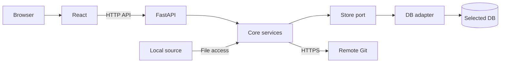
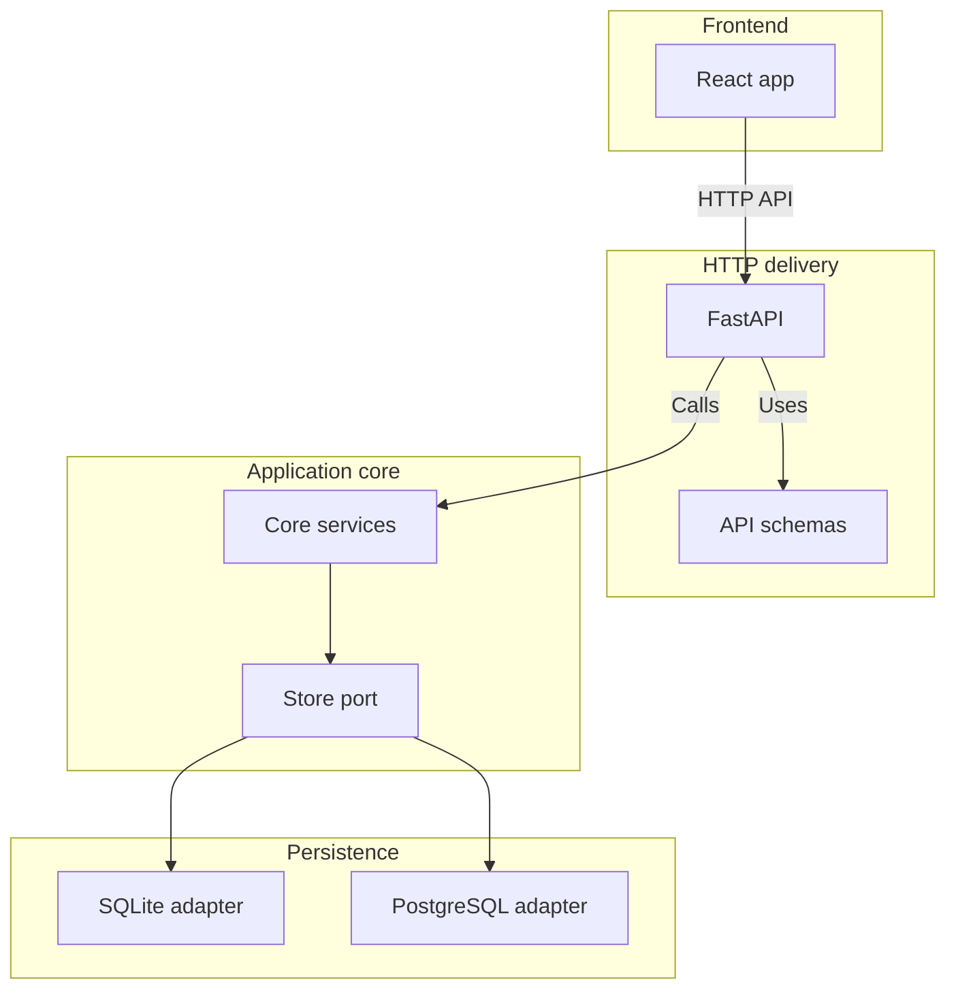
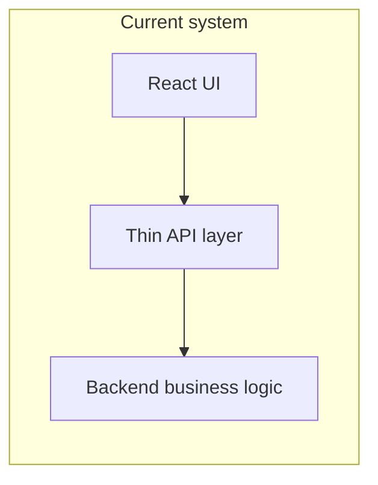
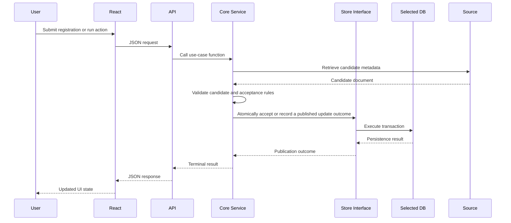
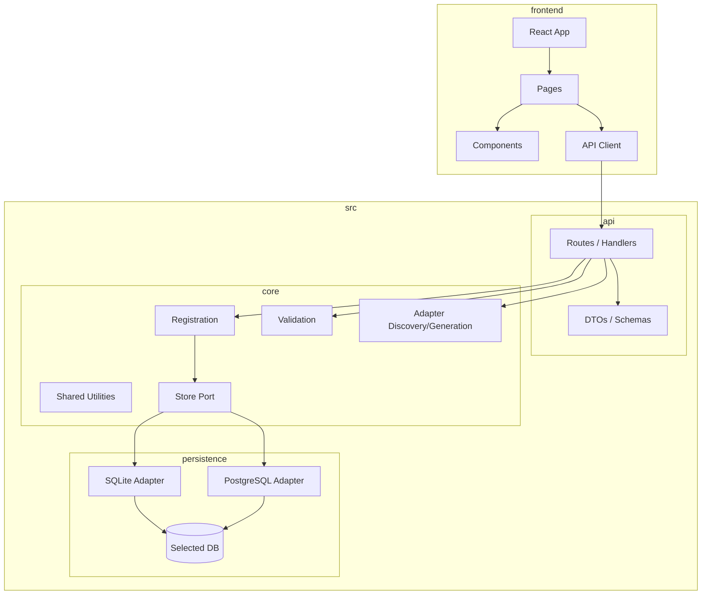

# Frontend Architecture

## Purpose

This document describes the implemented React/FastAPI boundary and the rules
that keep frontend concerns separate from backend business logic.

The design is intended to:

- preserve the current core implementation work
- avoid duplicating business rules in the frontend
- establish a stable API boundary between UI and backend
- use generated clients derived from the deployed FastAPI contract
- keep future deployment or repository changes from altering business rules

## Architectural Direction

The dedicated React application consumes the FastAPI JSON and SSE endpoints.
“HTTP API” below names the logical contract. Local development uses HTTP on
localhost; production browser traffic uses HTTPS to Nginx, which proxies to
FastAPI over private HTTP. See the
[deployment transport conventions](../deployment.md#transport-conventions).

The backend should be split conceptually into:

1. a framework-agnostic core service layer
2. a thin HTTP/API adapter layer
3. persistence adapters for SQLite and PostgreSQL

This keeps the backend logic reusable independently of UI and deployment
changes.

## Design Goals

The frontend architecture should:

- provide a professional and maintainable user experience
- replace current frontend responsibilities incrementally or fully
- keep all validation, duplicate detection, status transitions, and persistence rules in the backend
- expose explicit JSON contracts for UI interactions
- minimize coupling between the UI and the backend framework
- support both configured persistence backends through one store boundary

## Implemented Layered Architecture



`Selected DB` is SQLite or PostgreSQL. A remote Git repository is fetched over
HTTPS; a server-local source is read from the backend filesystem and is not a
browser-local repository.

## Backend Separation

React communicates with the backend through FastAPI. FastAPI owns HTTP routing,
schemas, and error mapping, then delegates business behavior to framework-free
core services. Replacing the delivery framework would not require rewriting the
core, but FastAPI is the implemented and supported HTTP layer.



## Frontend and Backend Responsibility

React owns presentation and interaction state. FastAPI translates HTTP
contracts, while core services and persistence own application behavior and
durable state.



## Main Request Flow



First-registration failures return diagnostics without source, entry or event
records. Registration progress can stream before the terminal result, but only
that final result confirms publication. UI clients must not automatically repeat
a disconnected publication POST. See the frontend API contract for these
registration-specific details; the other architecture guidance remains the
original baseline.

## Suggested Module Layout



## Recommended API Boundary

The React frontend should communicate with the backend through explicit JSON
endpoints aligned with existing use cases.

The current screen-by-screen frontend API contract is documented in:

```text
sdlc_docs/b_design/frontend/frontend_api_contract.md
```

Current endpoints use the `/api/v1` prefix and should call the existing core
services instead of reimplementing business behavior in route handlers.

## Frontend Responsibilities

The React frontend should own:

- page layout and navigation
- form state and validation for user input ergonomics
- rendering of registration, status, and registry operations views
- API calls and response handling
- loading, empty, success, and error states

The React frontend should not own:

- canonical validation rules
- duplicate detection policy
- checksum logic
- status transition rules
- persistence logic

## Backend Responsibilities

The backend should remain responsible for:

- synchronous registration acceptance and terminal attempt results
- metadata discovery from local or remote repositories
- adapter and dataset validation
- duplicate detection and uniqueness enforcement
- canonical registry entry persistence
- registration event history
- manual batch refresh and owner-authorized adapter updates

## Implementation Status and Remaining Options

Implemented:

- React owns the browser workflows under `frontend/`.
- FastAPI exposes request/response models around shared core services.
- The checked-in OpenAPI document generates the TypeScript client.
- SQLite and PostgreSQL implement the shared persistence boundary.

Optional future changes include splitting deployment units or repositories.
Those changes should preserve the API, core-service, and persistence boundaries
rather than introduce a second implementation of business rules.

## Key Architectural Rules

- Business rules must remain in backend services, not in React components.
- UI-to-backend integration should be contract-based and JSON-oriented.
- FastAPI route handlers must stay thin enough that core services remain reusable.
- The React frontend should be framework-agnostic with respect to backend implementation details.
- SQLite and PostgreSQL behavior should remain compatible at the store boundary.

## Expected Benefits

- clearer separation of concerns
- better maintainability of frontend and backend code
- easier frontend modernization without backend rewrites
- generated transport types that track the FastAPI contract
- improved long-term testability and extensibility

## Relation to User Stories

This design primarily supports:

- `US-04a` Registration UI and submission persistence
- `US-08` Non-blocking batch refresh
- `US-09` On-demand retries and adapter updates
- `US-11` Run summary reporting
- `US-12` React front-end migration
