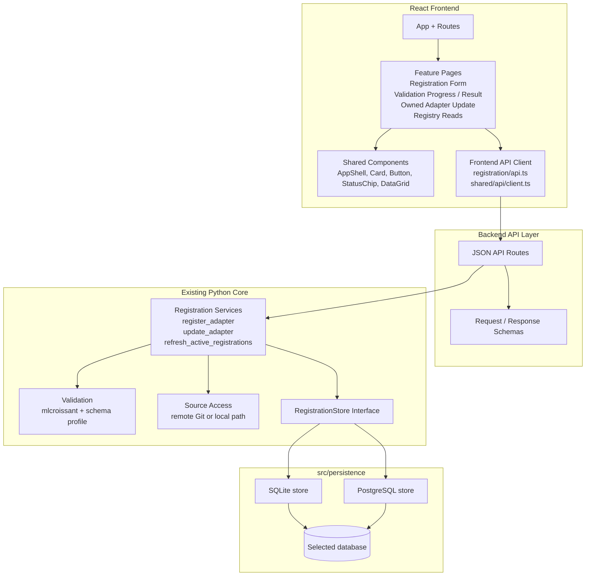
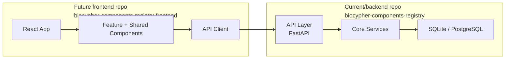

# Frontend Design

## Purpose

This document is the primary guide for designing and implementing the React frontend for the BioCypher Components Registry.

It is intended to align work between project maintainers and AI agents. It should be used before making frontend implementation decisions, creating React components, adding routes, or changing API integration behavior.

The frontend supports the SQLite and PostgreSQL persistence configurations
through the same FastAPI contract. A future repository split must preserve that
contract and must not move business rules into the browser.

## Project Context

The BioCypher Components Registry has a React frontend under `frontend/`, a
FastAPI delivery layer under `src/api`, business logic under `src/core`, and
SQLite/PostgreSQL adapters under `src/persistence`.

The React frontend should:

- provide a modern, maintainable user experience
- reuse existing backend business logic through API boundaries
- avoid duplicating validation or persistence rules in the browser
- support normal users and maintainers
- be easy to move into a standalone frontend repository later
- use generated clients derived from the FastAPI OpenAPI document

## User Roles

### Users

Users can:

- explore adapters
- create Croissant metadata
- register adapters
- read documentation or guidance

Normal-user navigation should include:

- `Create`
- `Register`
- `Explore`
- `Docs`

### Maintainers

Maintainers can:

- inspect registry internals
- monitor active registration sources
- review validation and processing outcomes
- update owned published adapters; global batch refresh remains CLI maintenance
- apply supported online actions through API-backed workflows

Maintainer navigation can extend the normal navigation with:

- `Registry`

The `Registry` area should be treated as maintainer-facing.

## Core Frontend Scope

Registration now consists of one repository submission followed by validation
and a terminal publication result. The registration-specific states are:

- signed-out and signed-in form states
- repository preflight and request validation errors
- live file/JSON, Croissant, profile, semantic and per-dataset checks
- confirmed publication with its accepted version
- rejected first registration with actionable diagnostics and no saved record
- unconfirmed connection loss without automatic resubmission
- owner-authorized published adapter updates
- unchanged updates and failed updates that retain accepted metadata
- read-only registry source/history and latest CLI batch summary views

Older staged registration and revalidation wireframes remain historical visual
references. Their process/revalidation buttons and browser batch trigger are not
current endpoint contracts. The other visual, metadata-creation and layout
guidance below remains the baseline design.

## Existing Design References

Design tracking:

- `sdlc_docs/b_design/frontend/frontend_penpot_design_tracking.md`

Frontend architecture:

- `sdlc_docs/b_design/frontend/frontend_architecture.md`

Frontend API contract:

- `sdlc_docs/b_design/frontend/frontend_api_contract.md`

PNG references:

- `sdlc_docs/b_design/frontend/penpot_first_look/`

HTML/CSS prototypes:

- `sdlc_docs/b_design/frontend/html_prototypes/register_flow/`

Important prototype entry point:

- `sdlc_docs/b_design/frontend/html_prototypes/register_flow/index.html`

## Visual Direction

The visual direction is inspired by the Apache Airflow Registry.

The UI should feel:

- professional
- spacious
- trustworthy
- discoverable
- readable for technical and non-technical users

The interface should use:

- light blue-gray page backgrounds
- white cards
- subtle borders
- restrained shadows
- clear blue primary actions
- semantic status colors
- dashboard-style tables for maintainer workflows

Suggested tokens:

```text
Background: #F6F9FC
Surface: #FFFFFF
Surface soft: #F8FAFC
Primary text: #111827
Secondary text: #637381
Border: #D9E2EC
Primary blue: #2563EB
Soft blue: #E8F3FF
Success: #16A34A
Success soft: #DCFCE7
Warning: #D97706
Warning soft: #FEF3C7
Error: #DC2626
Error soft: #FEE2E2
Cyan: #06B6D4
```

## React Principles

All frontend work must respect React principles.

### Component Model

- Build small, focused components.
- Prefer composition over large monolithic components.
- Keep page components responsible for layout and data orchestration.
- Keep reusable UI components generic and presentational where possible.
- Avoid duplicating the same card, badge, button, and table patterns across pages.

### Data Flow

- Data should flow from API client calls into page-level state and then into child components via props.
- Avoid hidden global mutable state.
- Avoid storing derived values in state when they can be computed from API data.
- Keep backend-derived status transitions in the backend.

### Business Logic Boundary

The React frontend must not own backend business rules.

Do not implement these only in React:

- adapter validation rules
- duplicate detection policy
- checksum logic
- canonical registry entry creation rules
- status transition rules
- persistence rules

The frontend can implement lightweight user-experience validation, such as:

- required field checks
- email format checks
- checkbox required before submit
- helpful disabled states

But the backend remains the source of truth.

### Effects And API Calls

- Keep API calls in dedicated API-client functions.
- Avoid scattering raw `fetch` calls across components.
- Use effects only for synchronization with external systems, such as loading data from the API.
- Keep effect dependencies explicit and correct.
- Avoid using effects to derive local UI state that can be computed during render.

### Forms

- Forms should be controlled or use a deliberate form library if adopted later.
- Form state should be easy to inspect and validate.
- User-facing validation messages should be clear and close to the affected field.
- Submitting a form should call a typed API function.

### Tables

- Maintainer registry tables should follow familiar dashboard/data-grid patterns.
- Tables should support filtering, sorting, pagination, and row-specific actions.
- Column filters should map to backend query parameters where possible.
- Row CTA buttons should be derived from current row state.

### Styling

- Start with CSS modules, plain CSS, or a lightweight styling approach.
- Keep design tokens centralized.
- Do not hardcode colors repeatedly across components.
- Prefer semantic class names and reusable primitives.

### Accessibility

- Use semantic HTML elements.
- Use real buttons for actions.
- Use labels for form fields.
- Keep contrast readable.
- Make focus states visible.
- Do not rely only on color to communicate status.

## Recommended Current Repository Layout

Start the React frontend inside the current repository.

This keeps development fast while the API contract and UI are still evolving.

## Architecture Diagram

The React frontend should depend on the backend through an explicit API layer.



Key rule:

- React must depend on API contracts, not Python internals or database tables.

```text
biocypher-components-registry/
├── src/
│   ├── api/
│   ├── core/
│   │   ├── registration/
│   │   ├── validation/
│   │   ├── adapter/
│   │   └── web/
│   └── persistence/
├── frontend/
│   ├── package.json
│   ├── vite.config.ts
│   ├── index.html
│   ├── src/
│   │   ├── app/
│   │   │   ├── App.tsx
│   │   │   └── routes.tsx
│   │   ├── features/
│   │   │   └── registration/
│   │   │       ├── api.ts
│   │   │       ├── types.ts
│   │   │       ├── pages/
│   │   │       │   ├── RegistrationFormPage.tsx
│   │   │       │   ├── RegistrationDetailPage.tsx
│   │   │       │   ├── RevalidationResultPage.tsx
│   │   │       │   └── RegistryOperationsPage.tsx
│   │   │       └── components/
│   │   │           ├── RegistrationForm.tsx
│   │   │           ├── RegistrationStatusBadge.tsx
│   │   │           ├── RegistrationFactsCard.tsx
│   │   │           ├── EventHistoryCard.tsx
│   │   │           └── RegistrySourcesTable.tsx
│   │   ├── shared/
│   │   │   ├── api/
│   │   │   │   └── client.ts
│   │   │   ├── components/
│   │   │   │   ├── AppShell.tsx
│   │   │   │   ├── Button.tsx
│   │   │   │   ├── Card.tsx
│   │   │   │   └── StatusChip.tsx
│   │   │   └── styles/
│   │   │       ├── tokens.css
│   │   │       └── global.css
│   │   └── main.tsx
│   └── README.md
├── sdlc_docs/
└── tests/
```

## Future Repository Split

Move the frontend to its own repository only after the API contract is stable and the first real workflows work end-to-end.



Future backend/API repository:

```text
biocypher-components-registry/
├── src/
│   ├── api/
│   ├── core/
│   └── persistence/
├── tests/
├── sdlc_docs/
└── README.md
```

Future frontend repository:

```text
biocypher-components-registry-frontend/
├── src/
│   ├── app/
│   ├── features/
│   ├── shared/
│   └── main.tsx
├── public/
├── package.json
├── vite.config.ts
├── README.md
└── docs/
```

## API Boundary

The React frontend should communicate with the backend through explicit JSON APIs.

The current frontend-facing API contract is documented in:

```text
sdlc_docs/b_design/frontend/frontend_api_contract.md
```

Current API paths use the major-versioned prefix:

```text
/api/v1
```

Examples:

```text
POST /api/v1/registrations
GET /api/v1/registrations/{registration_id}
POST /api/v1/registrations/stream
POST /api/v1/adapters/{adapter_id}/update
GET /api/v1/registry/registrations?latest_event=FETCH_FAILED
GET /api/v1/registry/refreshes/latest
GET /api/v1/adapters
POST /api/v1/metadata/validate
```

Implementation note:

- Keep the API base URL centralized in the frontend configuration, such as
  `VITE_API_BASE_URL`.
- Do not scatter `/api/v1` literals across components.
- Registry reads may filter the latest event; publication and latest attempt
  are separate fields rather than a lifecycle status filter.

## Registration Data Model For Frontend

Use the generated OpenAPI types rather than maintaining a second lifecycle
enum. Relevant terminal attempt fields are:

```ts
type RegistrationAttemptStatus = "SUCCEEDED" | "FAILED";

type AttemptSummary = {
  attempt_status: RegistrationAttemptStatus;
  published_version?: string | null;
  update_applied: boolean;
  reason_code?: string | null;
  message: string;
};
```

Source/detail reads expose accepted metadata and `latest_attempt` separately.
Registry rows include `published_version` and `latest_event_type`; a failed
candidate must not replace a successful published version in the UI.

Active processing and unconfirmed disconnection are UI states. Validation checks
use `PENDING`, `RUNNING`, `PASSED`, `FAILED` and `NOT_RUN`, distinct from attempt
status. Display the field locations, requirements and schema provenance supplied
by the backend, and fetch exact schemas from `/api/v1/schemas/{version}`.

The backend supplies `can_update` and `can_delete` for published adapters. Use
these capabilities to show actions, while retaining server-side authorization.
Retries of rejected first submissions use the registration form; updates of
published adapters use `/api/v1/adapters/{adapter_id}/update`.

## Implementation Plan

### Phase 1: Frontend scaffolding

- Create `frontend/` using Vite, React, and TypeScript.
- Add routing.
- Add global styles and design tokens.
- Add shared primitives: `AppShell`, `Button`, `Card`, `StatusChip`.
- Add mock data for registration flows.

### Phase 2: Static registration pages

Implement static pages from the wireframes and prototypes:

- `RegistrationFormPage`
- `RegistrationDetailPage`
- `RevalidationResultPage`
- `RegistryOperationsPage`

Use mock data first.

Do not connect to the backend yet.

### Phase 3: Registration components

Extract reusable components:

- `RegistrationForm`
- `RegistrationStatusBadge`
- `RegistrationFactsCard`
- `CanonicalEntryCard`
- `ValidationErrorsCard`
- `EventHistoryCard`
- `RevalidationResultCard`
- `RegistrySourcesTable`
- `RegistryMetricsRow`
- `RegistryFilterToolbar`

### Phase 4: Backend API layer

Add a thin JSON API layer around existing backend services.

The API layer should call existing functions such as:

- `register_adapter`
- `update_adapter`
- `refresh_active_registrations`

Do not move backend business rules into the API route handlers.

The API route handlers should translate HTTP requests into service calls and serialize responses.

### Phase 5: Replace mock data with real API calls

- Add `frontend/src/shared/api/client.ts`.
- Add `frontend/src/features/registration/api.ts`.
- Replace mock registration data with backend calls.
- Add loading, success, and error states.
- Add table query parameters for filters.

### Phase 6: Complete registration functionality

The implemented registration workflow supports:

- one authenticated registration request with live validation checks
- field-level and available file-position diagnostics
- confirmed publication or a rejected first attempt without persisted records
- an unconfirmed result when the terminal response is lost
- owner-authorized updates and unchanged/failure feedback
- preserved accepted metadata after failed updates
- event history and read-only latest batch summary

The former staged process/revalidation actions and browser batch trigger are
replaced by this contract. Remaining visual milestones can reuse the original
design principles and prototype references without restoring those old APIs.

### Phase 7: Prepare for frontend repository extraction

Before moving to a standalone repository:

- stabilize API endpoints and response shapes
- remove direct coupling to backend filesystem paths
- document environment variables
- document local development setup
- add frontend tests for critical flows
- define deployment assumptions

Only then move `frontend/` to a separate repository.

## Definition Of Done For First Frontend Milestone

The first milestone is complete when:

- React app runs locally
- registration form page exists
- registration progress/result handles accepted, failed and unconfirmed outcomes
- owned adapter updates preserve published state when a candidate fails
- registry operations page includes Material UI-style table behavior at the UI level
- components are organized by feature and shared primitives
- styles use centralized tokens
- no backend business rules are duplicated in the frontend
- API integration points are isolated in API client modules

## Agent Instructions

When AI agents work on the frontend, they must:

- read this document first
- preserve React component boundaries
- keep backend business rules out of React components
- prefer small components and explicit props
- avoid hardcoded repeated colors when tokens exist
- avoid adding broad state management before it is necessary
- avoid introducing a UI library without explicit approval
- keep API calls inside API modules, not scattered in components
- update this document when major frontend architecture decisions change

## Open Decisions

- Whether to use a component library later, such as Material UI, or implement dashboard-style patterns with custom components.
- Whether to use a form library for registration forms.
- Whether to use a data-fetching library such as TanStack Query once API integration begins.
- Whether `Registry` should be hidden entirely for normal users or shown only after maintainer authentication.
- Whether the frontend repository split should happen before or after discovery/browse functionality is implemented.
